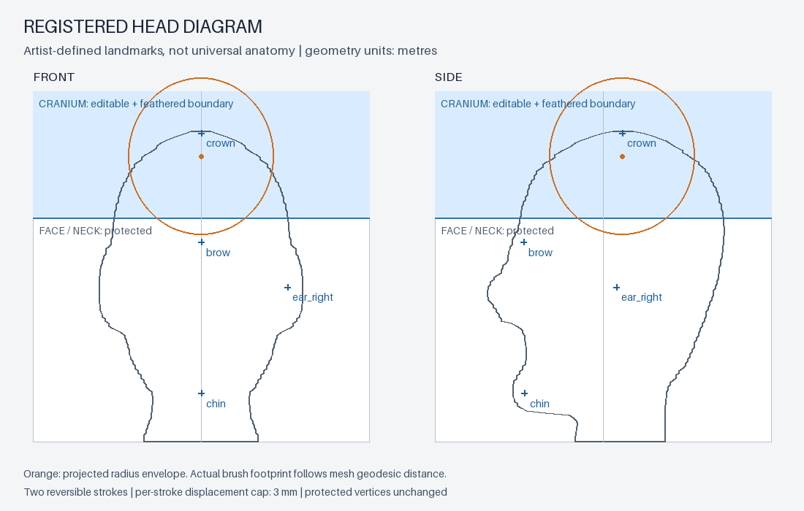
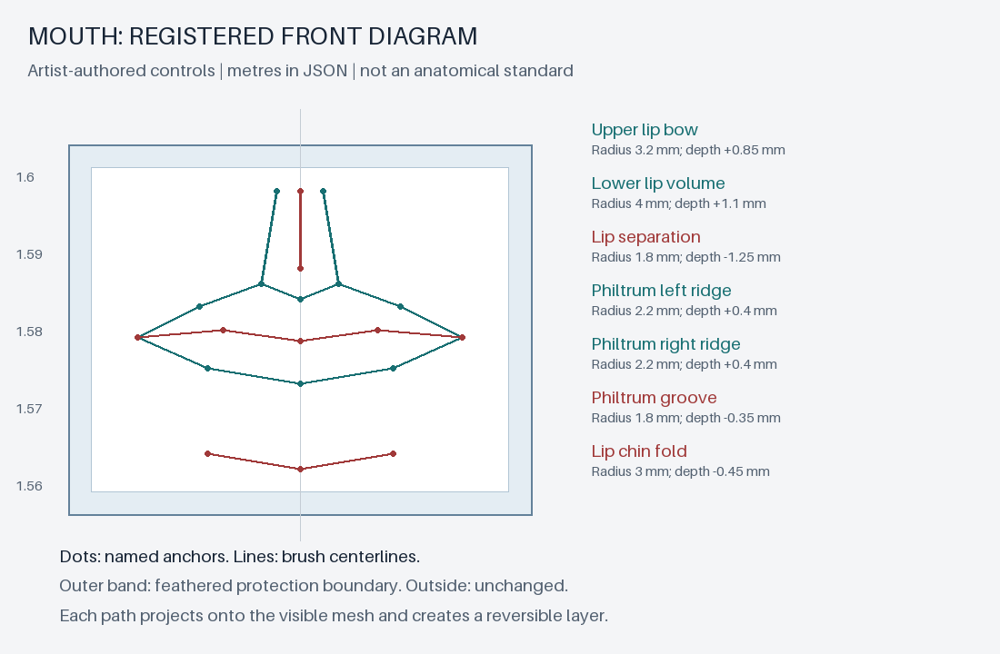

# Registered anatomy diagram brushes

The diagram is an editable registration for the included procedural adult. It is
not a population-average chart, automatic anatomical detector or an accuracy
certificate. World coordinates use metres; brush distances use millimetres.



## Controls

`examples/human-anatomy-diagram.json` defines named landmarks and regional bounds.
Only the cranium region is enabled in this first pass. Face, neck and body remain
protected. Other landmarks are reference points for later regional work.

- `anchor`: named world landmark; `offset_mm`: horizontal/vertical diagram offset.
- `view`: front projects along +Y; side projects along -X. The first surface hit
  locates the brush. A miss or a hit outside the selected region fails unchanged.
- `radius_mm`: geodesic radius along mesh edges; boundary feathering limits edits.
- `mode`: `smooth` or signed `normal`; `strength`, `steps`, `distance_mm` set action.
- `max_displacement_mm`: cumulative cap for one stroke, not all strokes combined.
- `symmetry_x`: mirrors the surface footprint across world X=0; overlap uses the
  stronger influence. An asymmetric source is not automatically made symmetric.
- `protect_mask`: optional existing workbench protection mask, additionally applied.

The orange diagram circles show projected radius envelopes, not the exact
geodesic footprint. The blue region is editable; feathering applies inside it.
`crown` marks the measured source summit; `crown_guide` is the working anchor below
it. Adjust registration for a different subject before brushing.

## Reproduce

Use one factory-startup Blender process with two threads at a time. Set numerical
library thread limits to two in the calling environment.

```text
blender -b --factory-startup -t 2 --python-exit-code 2 --python examples/human_base.py -- runs/human-input
blender -b --factory-startup -t 2 --python-exit-code 2 --python examples/human_guided_brush.py -- runs/human-input/human-base.blend runs/human-guided
python examples/draw_anatomy_diagram.py runs/human-guided/diagram-preview.json runs/human-guided/diagram.png
```

The last command requires Pillow. Each Blender example requires a fresh output
directory. The guided example retains the original object and its modifiers/keys,
creates a new evaluated snapshot, then adds reversible brush keys. It does not
transfer prior editable masks/layers onto that snapshot; they remain on the
preserved source. The new diagram binds to the snapshot's topology and transform.
Topology or transform changes require registration again.

## Python API and evidence

`anatomy.bind(obj, diagram)` validates and stores registration on a static baked
mesh. `anatomy.stroke(obj, command)` reprojects the anchor to its current surface
and creates a workbench layer. `sculpt.set_layer(obj, layer_name, 0)` disables it.
Unsupported active modifiers are rejected; do not bake a user's original mesh.

Blender 5.2.2 LTS: the focused test in `tests/blender_tests.py` checks real normal
and smooth deformation, protected vertices, displacement limits, rollback and
invalid/missed/out-of-region/stale commands. The included skull run preserves
64,220 protected vertex coordinates exactly and verifies source preservation and
both-layer rollback. Two strokes produce about 1.22 mm maximum total displacement.
The underlying 6 mm fused head still limits visible fine detail. This tool places
and bounds edits precisely; it does not supply anatomical ground truth.

## Lower-face profile example

`examples/human_lower_face.py` consumes the guided native file and applies
`examples/human-lower-face.json`. A new mesh has only the lower-face patch
subdivided. Authored sagittal Z/Y/half-width rows produce a reversible profile
layer, followed by registered smoothing strokes. The measured nose-base,
philtrum, lip and chin positions are recorded before and after editing.

```text
blender -b --factory-startup -t 2 --python-exit-code 2 --python examples/human_lower_face.py -- runs/human-guided-cranium/human-guided.blend runs/human-lower-face
```

The source object's earlier keys remain intact. The new mesh gets a fresh diagram
binding; prior topology-bound masks are not silently reused. This edits the broad
profile, not nostril cavities or detailed lip topology.

## Registered mouth paths

`anatomy.path_stroke(obj, command)` follows a front-view polyline of named
`anchors`. Unlike the point brush, its radius is measured in the X/Z diagram
plane. Positive `distance_mm` moves the visible surface toward -Y; negative
distance recesses it. Landmark Y coordinates do not set the resulting depth.
Each vertex receives one falloff weight based on the nearest path segment,
so overlapping segments do not accumulate displacement within a stroke.

The region, feather and optional `protect_mask` constrain the footprint.
An additional visibility ray excludes rear surfaces. Paths are sampled at
at most 1 mm spacing (or half the radius when smaller) to reject misses and
out-of-region centerlines before creating a key. The per-path displacement
limit is enforced before editing; multiple layers can add together.
This is front-projected authoring, not a geodesic path or automatic anatomy fit.



`examples/human-mouth-diagram.json` defines the upper lip bow, lower lip volume,
lip separation, two philtrum ridges, philtrum groove and lip/chin fold.
The same coordinates generate the diagram and drive the seven reversible paths.
Left and right controls are explicit; this API does not implicitly mirror them.

```text
blender -b --factory-startup -t 2 --python-exit-code 2 --python examples/human_mouth.py -- runs/human-lower-face-final/human-lower-face.blend runs/human-mouth
python examples/draw_mouth_diagram.py examples/human-mouth-diagram.json docs/assets/human-mouth-diagram.png
```

The example subdivides only the mouth patch into a new object and registers a
fresh diagram. Source layers remain preserved on the input object.
Focused tool checks: `tests/anatomy_path_test.py` verifies measured forward
movement, rear-sheet protection, boundary protection, rollback, six atomic
failure cases and stale-transform rejection. The native example also verifies
source preservation and closed edges. Fine lip anatomy, an open mouth and
anatomical reference matching are not implemented.
