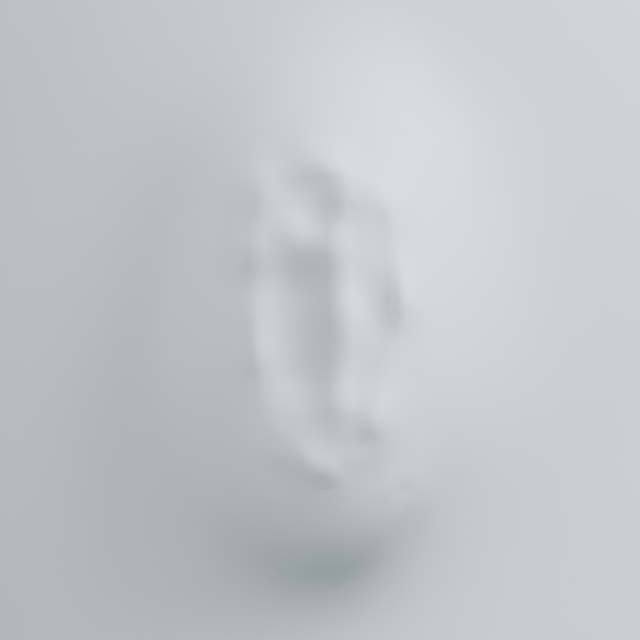
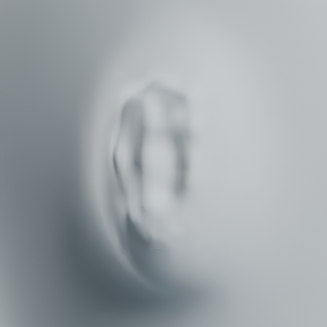

# Bilateral sampled-surface auricle relief

Stage B starts with clearer lateral ear relief on the preserved character.
`anatomy_ear.compile_relief` reuses the manually registered `auricle-v1` guide,
then emits 21 `curve_fit` controls for each ear. `apply_relief` applies one or two
disjoint ears atomically, retaining a reversible layer for each side and removing
temporary intermediate objects. It compiles every registration before editing.

## Knowledge and authored shape choices

[NIH ear anatomy](https://elementsofmorphology.nih.gov/anatomy-ear.shtml) describes
the outer helix, branched antihelix, concha, tragus, lobule, scapha between the
helix/antihelix and triangular fossa between the antihelical branches and ascending
helix. The existing knowledge file now records the two concavities as optional
relief features. Its original normalized landmarks and brush paths are unchanged.

Default displacement parameters are `rim_mm=1.4`, `inner_mm=1.0`,
`concha_mm=1.6`. The latter recesses the surface; other named controls project
outwards on their registered side. Concavity midpoints, depths, radii and ratios
are authored modeling choices. This is a lateral relief operation, with no open
auditory canal, free rolled rim, cartilage thickness or anatomical validation.

The four references per ear remain anterior/posterior/superior/inferior skin
points. The example reprojects their authored Y/Z locations to the current side
surface; this is not automatic anatomical landmark recognition. The compile
step rejects references more than 0.1 mm off the visible skin.

## Reproduce and evidence

Run `examples/human/ears/relief.py` inside factory-startup background Blender,
with two CPU/numerical threads. Input:
`runs/human/chin-contour/chin-contour.blend`; second argument is a fresh output
folder. Current native: `runs/human/auricle-relief/auricle-relief.blend`.

Blender 5.2.2 LTS: 21 controls and 498 changed vertices per ear; maximum combined
movement 1.83345 mm. 82,041 out-of-region vertices are unchanged. Source/topology
preservation, paired rollback, two invalid registrations and an injected failure
on the second ear's layer finish pass. The failure leaves no partial first ear
or temporary mesh. Minimum changed polygon area ratios are 0.94062/0.94097.
Maximum target surface distance is 0.03510 mm.

Saved-native coordinates and unchanged input SHA256 pass. Four matched
640px/16-sample before/after renders were inspected; Blender exited.

| Source right | Current right |
| --- | --- |
|  |  |

**Visual gate remains open.** Relief is more distinct, but the outer/inner ridges
are scalloped around individual controls and the ear still resembles shallow
surface relief. The left oblique view makes this particularly clear. Numerical
control accuracy does not prove a convincing ear. Next: continuous ridge paths
and sufficient local mesh resolution, before treating the ear substep as reviewed.
Neck-to-chin/shoulder work also remains pending in stage B.
