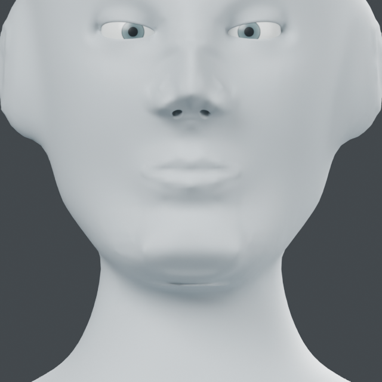
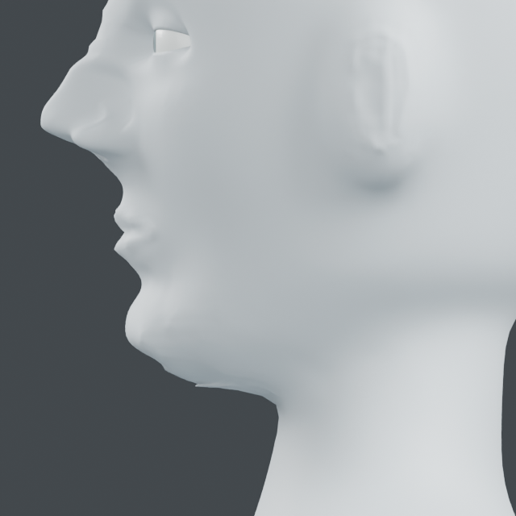

# Chin contour: registration, fairing and projection

The matched source profile exposed a stepped transition below the chin. This
pass fairs that local surface and separately controls the central projection,
paired shoulders and anterior jaw transition. It preserves the oral, nasal and
eyelid edits above Z=1.558 m on this authored character.

## Knowledge and registration

`chin-contour-v1.json` separates qualitative references from authored offsets.
[NLM MeSH: Chin](https://www.ncbi.nlm.nih.gov/mesh/D002680) identifies the chin
as the anterior mandibular region including the mental protuberance.
[NIH oral anatomy](https://elementsofmorphology.nih.gov/anatomy-oral.shtml)
identifies the mentolabial sulcus as the central lower boundary of the lip region.
Using that relationship to protect the existing lip work is a modeling choice.
No source illustrations or population measurements are copied.

`anatomy_fit.compile_chin_contour(source, registration, setback_mm=1.5,
narrowing_mm=1.2)` returns a nine-control `curve_fit` diagram. Registration is an
explicit visible-surface center, chin half-width and upper/lower protection
heights in world metres. Front is -Y; up is Z. Every generated control is
ray-projected to the current skin. Center residual greater than 0.1 mm is rejected.
The knowledge data is embedded in the result diagram; this is a dedicated
compiler, separate from `anatomy_fit.knowledge()` normalized path modules.

The example first uses a bounded `relax_volume` path to fair the stepped lower
chin. It then compiles the contour controls on that faired surface. The final
object retains both reversible layers. Turning both off returns to the input
geometry; the original object and its older layers also remain in the scene.

The 1.5 mm setback, 1.2 mm narrowing, relative control locations, fairing path,
radius and protection heights are authored choices for this character. They do
not infer bone shape, tissue mechanics, occlusion or a demographic norm.

## Evidence

Input: `runs/human/oral-transitions/oral-transitions.blend`.
Current native: `runs/human/chin-contour/chin-contour.blend`.
`examples/human/mouth/chin_audit.py` produces the matched input views and visible
surface samples. `examples/human/mouth/chin.py` creates the final native, diagrams,
report and two output views. Each takes input native and a fresh output folder.
Use factory-startup background Blender and two CPU/numerical threads.

Blender 5.2.2 LTS, one process at a time:

- Source/intermediate coordinates and topology preserved; 19,355 vertices above
  the oral protection height unchanged. Combined two-layer rollback passes.
- Three invalid registration/parameter inputs rejected; injected late failure
  leaves no object or mesh. Actual saved coordinates and unchanged input SHA256 pass.
- Fairing moves 1,027 vertices, then contour fitting affects 1,724 vertices.
  Maximum combined movement is 1.53701 mm. Central control setback is 1.49971 mm;
  maximum target surface residual is 0.00684 mm.
- Minimum changed polygon area ratios: fairing 0.51732, contour 0.90219.
  Fairing signed-volume difference: -0.00311 mm3, below the existing 0.1 mm3 limit.
- Two input and two output 640px/16-sample views inspected. Blender exited.

| Source front | Current front |
| --- | --- |
|  |  |

| Source profile | Current profile |
| --- | --- |
|  |  |

The stepped lower-chin profile is smoother and its central projection reduced.
The front-view difference is small. A shallow under-chin band remains near the
neck attachment and belongs to the next neck transition work. The face is still
stylized; static surface checks do not establish anatomical accuracy.

## Face-stage evidence handoff

| Stage A requirement | Evidence |
| --- | --- |
| Eyelid/globe connection | [Registered support, protected margins, source/readback/failure checks and views](EYELID_SUPPORT.md) |
| Lips/philtrum/chin | [Oral control and transition checks/views](ORAL_RELIEF.md), chin evidence above |
| Existing nasal tools integrated | Preserved nasal geometry in current input/result; [entrance](NASAL_ENTRANCES.md) and [tip/ala](TIP_ALA.md) records |
| Sourced relationships vs authored dimensions | Linked knowledge resources and explicit registration in each record |
| Actual shared static face | Current native and front/profile views above, with eye and nasal work retained |

The bounded static face-tool application/review criteria for stage A are met.
This does not claim a finished realistic head. Next is stage B: ears and
neck-to-chin/shoulder transitions, protecting the facial work. Stages B-G remain
unfinished and the full goal remains active.
