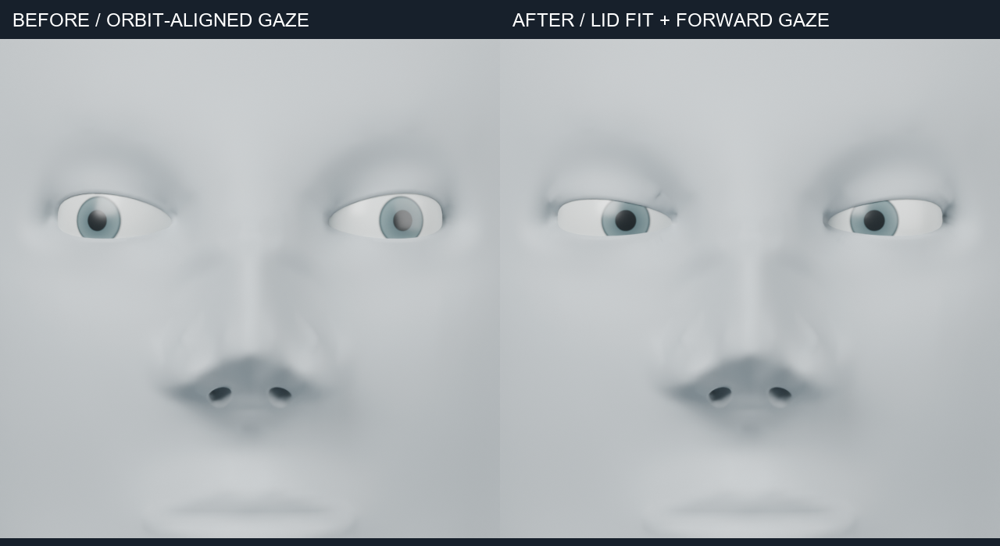

# 눈꺼풀–안구 지지와 시선 분리 — 진행 중

## 근거와 조형값

[NIH 눈 주위 해부 명칭](https://elementsofmorphology.nih.gov/anatomy-periorbital.shtml)은 눈꺼풀을 안구 앞쪽을 덮는 피부와 피하 구성요소로 설명하며, 상안검 주름을 관련 근육의 부착과 연결합니다.
이 관계를 `knowledge/eyelid-support-v1.json`에 기록했습니다. 그림이나 인구집단 치수는 복사하지 않았습니다.

`eyelid_fit.knowledge()`는 출처·관계·필수 등록값·검증 조건·한계를 반환합니다.
이 데이터는 기존 `anatomy_fit`의 정규화 경로 모듈과 별개인 지지 관계 자료입니다.
구형 안구, 간격, 개구 높이와 시선 설정은 조형용 근사값입니다. 눈꺼풀 조직층이나 연골판을 생성하는 기능이 아닙니다.

## 적용

`eyelid_fit.fit(source, eyes, name)`은 새 객체에 복귀 가능한 레이어를 만듭니다.
각 눈의 중심·반지름·기존 개구 폭과 높이·안와 방향을 명시적으로 등록해야 합니다.
기존 가장자리 정점과 등록값이 일치하지 않으면 거부합니다.
상·하안검 높이를 조정하면서 가장자리를 구형 지지면에 맞춥니다.
시선은 안와 방향과 분리하여 복사한 안구 객체에서 조정합니다.

이번 예제의 상안검 개구 높이는 6→4.7mm, 하안검은 4→3.4mm입니다.
안와 좌우 회전은 유지하고 시선 회전만 기존 ±25도에서 0도로 바꿨습니다.
초기 간격 설정은 안쪽 연결면을 과하게 압축해 면적 검사에서 거부됐습니다. 검사 기준을 낮추지 않고 외측 간격을 0.30mm로 조정했습니다.

## 확인과 미완료 항목

- Blender 5.2.2 LTS에서 눈당 113개 가장자리 표본의 실제 반지름 방향 간격은 약 0.110–0.292mm입니다.
- 최대 이동 1.63795mm, 비영향 정점 81,761개입니다. 코 보호 범위의 11,786개 정점은 동일합니다.
- 원본 얼굴·안구, 토폴로지, 레이어 복귀를 확인했습니다. 등록 오류 2종과 레이어 처리 중 실패 시 출력 제거를 확인했습니다.
- 저장 모델을 다시 열어 좌표 동일성을 확인했습니다. 지식 자료 API와 출처 키 참조도 확인했습니다.
- 정면·사선 640px/16샘플 렌더를 검사했습니다. CPU·수치 라이브러리 2스레드, Blender 단일 실행입니다.

정면 시선은 정렬됐지만 안쪽 눈꺼풀 모서리에 접힘이 남아 있습니다. **눈 부위의 시각적 완료 기준은 아직 통과하지 않았습니다.**
다음 작업은 그 접힘과 눈꺼풀–주변 피부 전환을 보정하는 것입니다. 눈물호수·눈물관·깜박임·각막 광학·실제 조직 두께는 구현하지 않았습니다.

현재 native: `runs/human/supported-eyelids/supported-lids.blend`입니다.
재현은 `examples/human/eyes/fit_lids.py`, 등록값과 검증 보고서는 native와 같은 폴더에 있습니다.
입력 `runs/human/tip-ala-refined/tip-ala.blend`는 보존했습니다.
