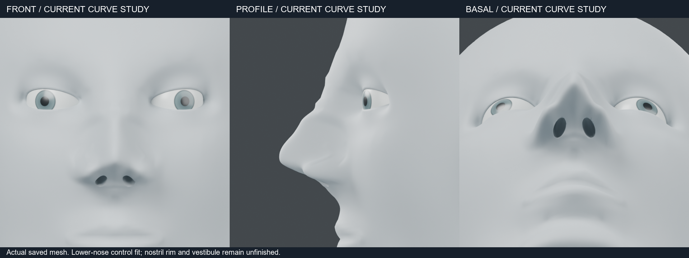
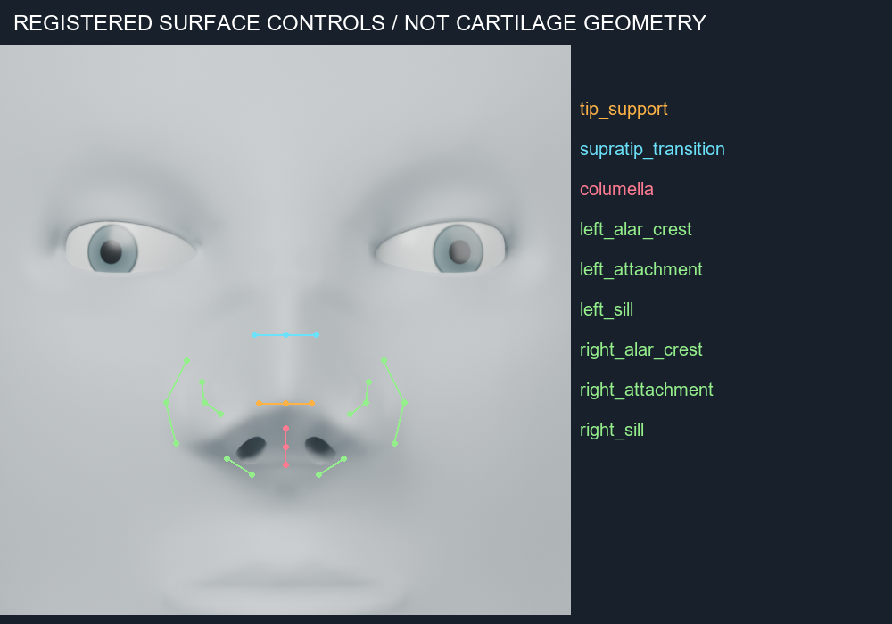

# 코 하부 제어점 적용 — 2026-10-24

기존 모델을 복사하고, 코끝·비주·콧날개·입구 바닥의 연결을 25개 제어점으로 조정했습니다. 기존 키와 선택·버텍스 그룹을 보존하며 새 변형 레이어를 끄면 이전 형상으로 돌아갑니다.

## 도식과 형상의 관계

[앞선 구조 검토와 출처](NOSE_AUDIT.md)를 바탕으로 다음 표면 제어선을 구분했습니다. 선은 연골 자체의 형상이나 위치를 보여주는 해부 도판이 아닙니다. 수치는 이 절차적 예제에 맞춘 조형값이며 인체 표준 비율이 아닙니다.

| 제어선 | 적용 |
| --- | --- |
| tip_support | 코끝 좌우와 중앙의 돌출·높이를 함께 조정 |
| supratip_transition | 콧등에서 코끝으로 이어지는 전환 조정 |
| columella | 코끝 아래에서 비주로 이어지는 중심선 조정 |
| alar_crest | 양쪽 콧날개의 폭·높이 조정 |
| attachment | 볼 부착부를 고정해 주변 변형 제한 |
| sill | 입구 아래 표면의 깊이 조정 |

표면을 직접 확인한 결과 측면의 코끝 아래 전환은 이어졌지만, 정면·아래쪽의 콧구멍은 여전히 타원형 절삭 흔적이 강합니다. 가장자리 두께와 전정 연결은 해결되지 않았습니다. 해부학적 완성이나 사실적인 코의 완성으로 판단하지 않습니다.

## 도구

`from mesh_workbench import curve_fit`

`curve_fit.apply(source, diagram, name)`은 새 객체와 검증 보고서를 반환합니다.
`diagram`은 미터 단위의 이름별 `source`/`target` 좌표, `region.min/max`,
`region.feather_mm`, `radius_mm`, `max_displacement_mm`를 받습니다.
예제의 `curves`는 점들의 의미상 연결을 기록하는 메타데이터이며, 연속 곡선 전체를 강제로 일치시키는 제약은 아닙니다.

입력 제어점은 원본 표면에서 0.05mm 이내여야 합니다. compact Wendland RBF로 제어점 이동을 보간하고 영역 경계에서 감쇠합니다. 사전 검사에서 과도한 이동과 다각형 면적 벡터의 반전·붕괴를 거부합니다. 기존 다각형 내부의 거의 일직선인 임시 삼각분할은 실제 면 반전으로 취급하지 않습니다. 전역 자기교차 검사는 제공하지 않습니다.

마스크와 선택 정의는 복사되지만 자동 보호 마스크로 적용하지 않습니다. 이번 변형의 보호 범위는 명시적인 영역 경계입니다. 기존 내부 공간도 영역 안에서는 함께 변형되며, 비강이나 연골을 새로 생성하지 않습니다.

## 확인 결과

- Blender 5.2.2 LTS, CPU·수치 라이브러리 2스레드, 한 번에 프로세스 1개입니다.
- 최대 이동 2.02465mm, 영역 밖 74,508개 정점이 동일합니다.
- 원본·토폴로지·선택·버텍스 그룹 보존, 레이어 복귀, 잘못된 입력 2종과 적용 중 실패 시 출력 제거를 확인했습니다.
- 저장 파일을 다시 읽어 제어 목표와 표면 사이 최대 거리 0.01389mm를 확인했습니다. 인체 정확도 오차가 아닙니다.
- 정면·측면·아래쪽 사선 640px/16샘플 렌더를 확인했습니다.

현재 native: `runs/human/lower-nose-curves/lower-nose.blend`입니다.
같은 폴더의 `diagram.json`, `verification.json`, `readback.json`이 적용 및 검증 기록입니다.
재현 스크립트는 `examples/human/nose/fit_lower_nose.py`이며 원본 입력을 덮어쓰지 않습니다.

다음 남은 작업은 **콧구멍 가장자리–입구 바닥–전정의 연결 표면**입니다. 현재 타원체 절삭 형상을 미세 브러싱만으로 완성 처리하지 않습니다.
