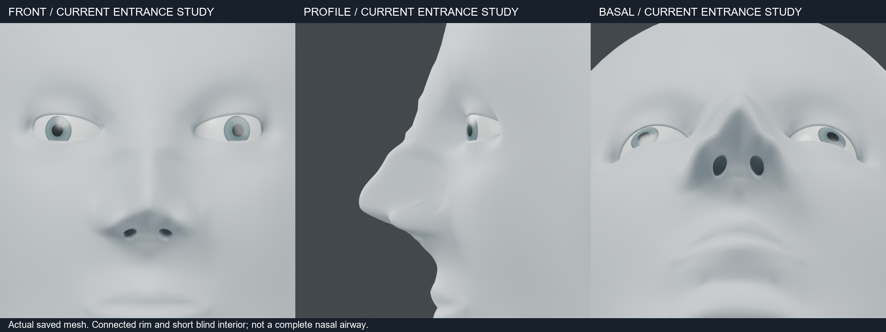
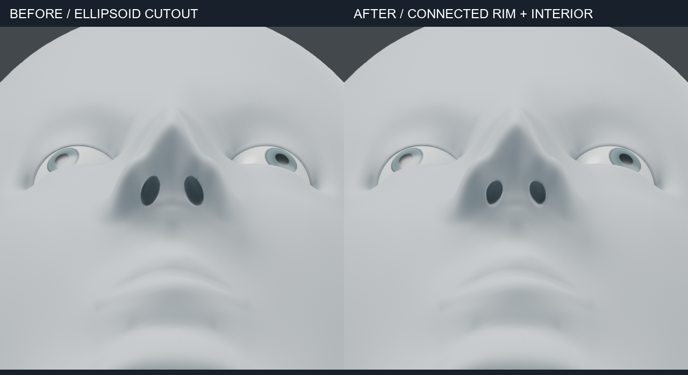

# 콧구멍 입구 연결면 — 2026-10-24

## 구현

`nasal_entrance.build`는 등록된 절삭면을 제거하고 기존 피부 경계에 이어지는 새 면을 생성합니다.
바깥 연결부, 입구 가장자리, 안쪽 벽, 막힌 바닥이 하나의 메시로 연결됩니다.
원본은 수정하지 않으며 결과는 새 토폴로지 객체입니다.

- 기존 피부 경계의 높이 변화를 입구 단면에 반영합니다.
- 기존 피부의 기울기를 받는 Hermite 연결면을 만듭니다.
- 절삭 경계의 불규칙한 간격에서 생기는 잔주름을 줄이기 위해 연결부와 바로 인접한 외부 정점만 완화합니다. 입구와 내부 링은 이 완화에서 제외합니다.
- 입력의 변형 레이어·마스크·선택은 원본에 남깁니다. 새 토폴로지에 이전 인덱스 기반 데이터를 옮기지 않습니다.
- 중간 단계 실패 시 새 객체와 메시를 남기지 않습니다.

첫 평면 단면에서는 위쪽 함몰이 나타났고, 곡률만 반영한 단계에서도 아래쪽 접합선에 잔주름이 남았습니다. 해당 실물 렌더를 근거로 연결 기울기와 국소 완화를 수정했습니다.

## 사용 범위

`from mesh_workbench import nasal_entrance`

`build(source, patches, name, reference_key='Basis')`는 새 객체와 보고서를 반환합니다.
`patches`는 1~2개의 입구 등록값입니다. `center`, `normal`, `across`는 원본 기준 키의 월드 좌표이며,
`width_mm`, `length_mm`, `cut_scale`은 교체할 영역을 결정합니다.
`aperture_scale`, `depth_mm`, `offset_mm`는 새 입구를 조정합니다.

이 예제의 입구 제어 폭 4.84mm, 길이 7.92mm, 내부 깊이 5.5mm는 조형값입니다. 인체 평균이나 적정 비율이 아닙니다.
[구조 검토](NOSE_AUDIT.md)의 표면 관계를 참고했지만, 연골 위치·조직 두께를 역추정하는 기능은 아닙니다.
기준 키와 절삭면이 일치하고 교체 경계가 단일 닫힌 고리를 이루는 입력만 지원합니다. 임의 인체 메시의 자동 입구 검출·재토폴로지는 지원하지 않습니다.

내부는 약 5.8mm 지점에서 닫히는 짧은 공간입니다. 실제 비강·기도 연결이나 조직 두께 모델을 완성한 것이 아닙니다. 닫힌 메시 검사와 자기교차 부재 보장은 별개입니다.

## 증거와 재현

현재 native는 `runs/human/nasal-entrances-smooth/nasal-entrances.blend`입니다.
같은 폴더에 `registration.json`, `verification.json`, `readback.json`을 기록합니다.
생성은 `examples/human/nose/build_entrances.py`, 저장본 확인은 `check_entrances.py`, 비교판 생성은 `entrance_board.py`입니다.
입력은 `runs/human/lower-nose-curves/lower-nose.blend`이며 덮어쓰지 않습니다.

Blender 5.2.2 LTS에서 원본 보존, 영역 밖 77,985개 정점 유지, 잘못된 등록 거부, 두 번째 입구 처리 실패 시 전체 취소를 확인했습니다.
양쪽 중앙 깊이는 약 5.8mm이며, 비다양체 경계는 없습니다.
한 번에 Blender 하나, CPU·수치 라이브러리 2스레드로 실행했습니다.

최종 저장본을 다시 열어 원본 레이어 보존과 새 객체의 선택·그룹 데이터 제외를 확인했습니다.
정면·측면·아래쪽 렌더에서 중간 단계의 접합 잔주름이 제거됐습니다. 다만 입구 형태는 아직 규칙적이며, 개인별 콧날개 비대칭과 연부조직 차이를 재현한 결과는 아닙니다.
실패한 중간 native 3개는 최종본 확인 후 삭제했고 해당 이미지·보고서는 남겼습니다.
