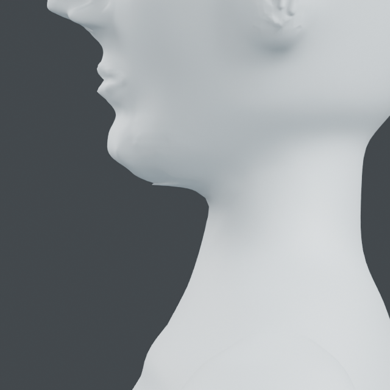
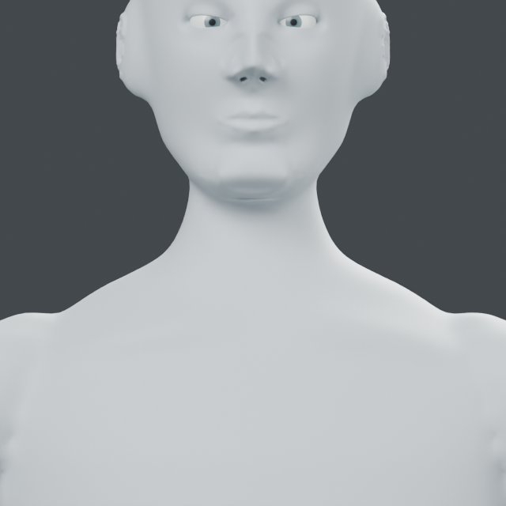
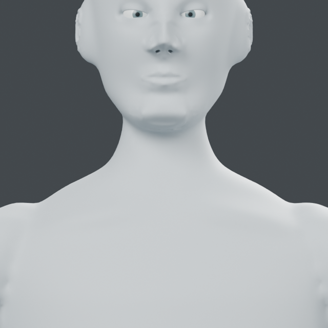

# Registered neck transitions and underside repair

The initial relaxation trial below left a folded underside. The later
[bounded patch reconstruction](#bounded-patch-reconstruction) removes that defect
on the current saved model; earlier findings are retained as evidence.

`mesh_workbench.regions.neck.compile_paths(source, registration)` compiles
explicit skin paths and regional bounds, without editing the input. Required
metre units, finite coordinates, visible-surface residual <=0.1 mm and upper
facial protection are checked. It returns a diagram and commands for
`surface_brush.apply`; the output snapshot has reversible stroke layers.
The new regional source folder is included in package data.

## Knowledge and scope

`neck-transition-v1.json` records relationships from
[UAMS topographical anatomy](https://medicine.uams.edu/neuroscience/education/medical-school-courses/human-structure-module/anatomy-tables/topographical-anatomy-tables/topographical-anatomy-of-the-head-and-neck/):
the anterior cervical triangle relates the midline, SCM anterior border and
mandible; the posterior triangle relates SCM, trapezius and clavicle; the
submental region relates the anterior digastric, midline and hyoid.
No source illustrations or numerical dimensions are copied.

The example's five paths are authored skin registrations: one submental fairing
path, two lower visible SCM ridges and two clavicle-transition fairing paths.
They do not locate bone or actual muscle attachments. Ridge amplitude 0.7 mm,
brush widths, protection height and fairing strengths are modeling choices.
Upper SCM insertion, posterior neck, internal anatomy and rigs are not covered.

## Native and checks

Input: `runs/human/continuous-ears-faired/continuous-ears.blend`.
Current trial native: `runs/human/neck-submental/neck-transitions.blend`.
Run `examples/human/neck/transitions.py` in factory-startup background Blender
with two CPU/numerical threads, passing input and a fresh output folder.
An optional third argument reuses existing matched source renders after checking
their report's input SHA256. It does not reuse result geometry.

Blender 5.2.2 LTS: source/topology preservation, 88,934 unchanged protected
vertices, 29,478 unchanged face/ear vertices above Z=1.535 m, all-layer rollback,
two invalid registrations, injected late failure cleanup, saved-coordinate
readback and unchanged input hash pass. Maximum combined movement is 1.61868 mm.
Two CPU/numerical threads, one Blender at a time; all processes exited.

## Visual evidence and unresolved defect

The first front-projected pass produced two before/two after 640px/16-sample
renders. The under-chin band remained. Changing submental traversal to an
inferior-front oblique view `[0, 0.8, 0.6]` and inspecting two new result views
still leaves a thin lower-chin projection. The visual gate therefore remains
open. The shallow neck-ridge changes do not resolve this defect.

A read-only saved-scene inspection found only the current head/body mesh,
two intended eyeballs and the studio floor visible for rendering. It is not an
overlapping preserved-head object. Next: inspect and reshape the local underside
surface itself, instead of repeating the same relaxation operation.

| Source profile | Current trial profile |
| --- | --- |
|  |  |

Stage B and the whole goal remain incomplete. A successful numerical test is not
evidence that the neck attachment is visually finished.

## Folded-surface diagnosis

`examples/human/neck/underside_audit.py INPUT.blend OUTPUT.json` reads the current
`Neck transition study` surface without editing or rendering. It samples four
lower-chin sections and enumerates vertical intersections in the local height
range. Current diagnostic: `runs/human/underside-audit/sections.json`.

At X=0, Y=-0.052 m, the same vertical ray crosses three surface sheets:

| Height Z (m) | Normal Z | Interpretation |
| --- | --- | --- |
| 1.52525282 | -0.99702 | Lower outward-facing sheet |
| 1.52527523 | +0.71434 | Fold return |
| 1.52645731 | -0.91509 | Upper outward-facing sheet |

Y=-0.0518 m also has three intersections. Neighboring samples at -0.054,
-0.053, -0.051 and -0.050 m have one intersection in this local band. The
lower-envelope height changes by 1.55437 mm from Y=-0.053 to -0.052 m.
This establishes a folded local surface in the input. It does not establish
that the entire mesh is globally free of other folds or intersections.

A bounded experiment including hidden return faces in volume relaxation was
rejected by the existing polygon guard at face 69104 (area 5.22027e-7 m2).
The source fold cannot be accepted as corrected by that operation. No result
native was produced, no guard was weakened, and the experimental brush option
was removed. The current saved model remains unchanged.

Next action: local patch reconstruction on a new object, preserving its outer
boundary and all unrelated geometry. Required checks are source preservation,
boundary continuity, single-sheet sections through this defect, failure cleanup
and actual saved-model before/after profile. Stage B is still incomplete.

## Bounded patch reconstruction

`mesh_workbench.regions.patch.rebuild(source, bounds, name, spacing_mm=1.5)`
replaces an explicitly selected local patch on a new topology snapshot. It
requires one boundary loop whose XY projection can be triangulated with an
unchanged, manifold seam. Constrained Delaunay triangles and a fixed-boundary
harmonic height solve produce a single-sheet patch. This is geometry repair,
not an anatomy inference algorithm or arbitrary retopology.

The boundary and every retained outside vertex keep their exact coordinates.
Original deformation layers, masks and selections remain on the preserved
source. Topology-bound selections/masks are deliberately not transferred to the
new output. Recovery uses the retained original object rather than shape keys
across different topology.

The first broader bounds intersected additional projected folds and were
rejected by the closed/oriented seam check. Final bounds in metres are
`[-0.023, -0.058, 1.520]` to `[0.023, -0.043, 1.537]` on this character.
No polygon or seam acceptance threshold was weakened.

Run `examples/human/neck/rebuild_underside.py` with the input
`runs/human/neck-submental/neck-transitions.blend` and a fresh output directory.
Current native: `runs/human/rebuilt-underside/rebuilt-underside.blend`.

Blender 5.2.2 LTS evidence:

- 100 boundary vertices and 91,081 retained/protected vertices unchanged.
- 345 old patch faces replaced by 610 triangles; height solve converged in 209 iterations.
- All 12 sampled sections through the defect cross the result exactly once.
  The earlier central sections crossed three times.
- Original coordinates unchanged; empty selection rejected; injected triangulation
  failure leaves no object/mesh; closed and consistently oriented seam and zero
  nonmanifold edges pass. Actual native coordinates and unchanged input hash pass.
- Two 640px/16-sample saved-model views inspected against the matched source views.
  One process, two CPU/numerical threads; Blender exited.

| Folded input profile | Reconstructed profile |
| --- | --- |
|  |  |

The thin under-chin projection is removed. A slight contour change at the fixed
boundary remains; no global intersection-free or anatomical-accuracy claim is
made. The local defect gate is closed on these measured sections and views.

## Stage B handoff

The [continuous ear ridges](AURICLE_RELIEF.md#continuous-path-pass), registered
lower-neck/clavicle paths, face protection and corrected under-chin attachment
provide the bounded static tool/application evidence for stage B. Ear thickness
and muscle detail remain stylized; upper SCM insertion and posterior neck were
not anatomically reconstructed. Next is stage C, torso/rib-cage/abdomen/pelvis
relationships and front/side/back silhouettes. The full goal remains active.
