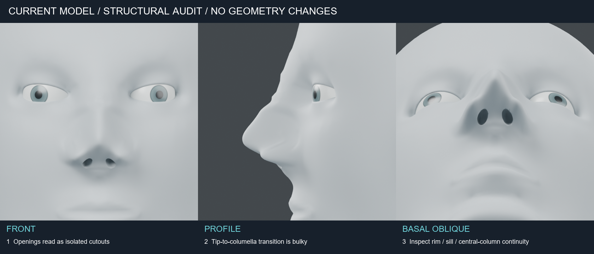
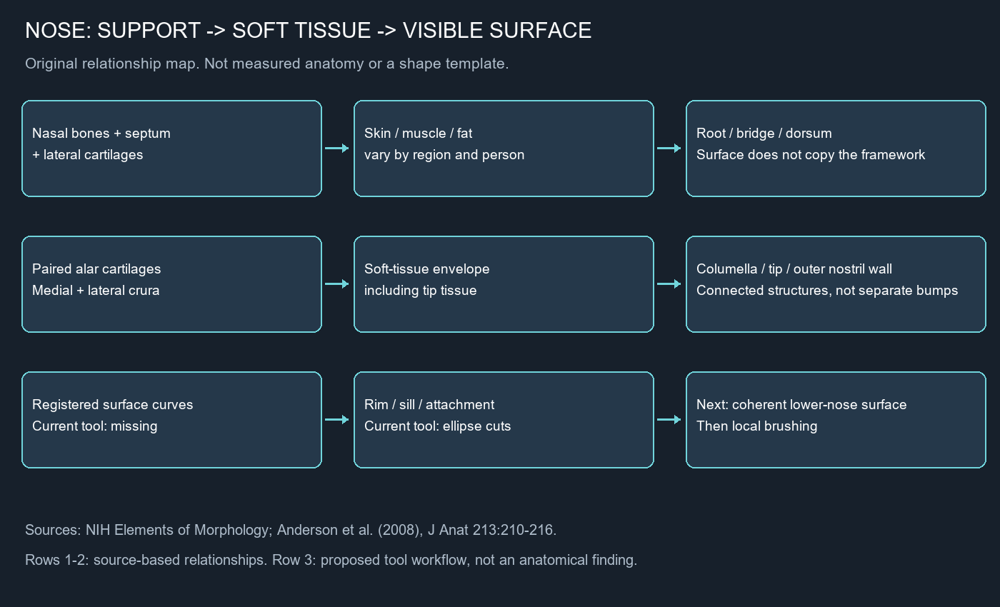

# 코 구조 검토 — 2026-10-24

현재 형상은 브러시 동작 시험용입니다. 해부학적으로 검증된 코로 취급하지 않습니다.
이번 작업은 자료 확인과 현재 형상 검토이며, 메시와 브러시를 수정하지 않았습니다.

## 구조 근거

- [NIH 표면 명칭](https://elementsofmorphology.nih.gov/anatomy-nose.shtml): 콧등, 코끝, 콧날개, 비주를 구분합니다. 비주는 두 콧구멍 사이를 연결하는 표면 조직입니다. 콧바닥 기준선과 중앙의 코-윗입술 접점을 같은 랜드마크로 취급하면 안 됩니다.
- [Anderson et al., 2008 — Anatomy of the nasal profile](https://pmc.ncbi.nlm.nih.gov/articles/PMC2526105/): 비골·비중격·외측연골·비익연골에 연부조직이 겹쳐 표면을 만듭니다. 비익연골의 내측각과 외측각은 비주·코끝·콧구멍 외측벽 형성에 관여합니다. 표면 윤곽은 내부 지지 구조의 윤곽을 그대로 복제하지 않습니다. 연구 대상은 고령 유럽계 시신 12구이므로 보편적인 치수 기준으로 쓰지 않습니다.

관계도는 위 자료를 요약한 자체 제작 설명도입니다. 해부 표본의 실측 도식이나 연골 배치 템플릿이 아닙니다. 원문 도판을 복제하지 않았습니다.

## 구현에서 확인한 한계

| 부위 | 현재 구현 근거 | 다음 형상 작업의 기준 |
| --- | --- | --- |
| 콧등–코끝 | `nasal_structure.py`의 단일 방향 돌출 함수 합성 | 콧등 단면과 코끝 전환을 정면·측면에서 함께 설정 |
| 코끝–비주 | 중앙 돌출 함수, 좌우 돔·내측각 등록 없음 | 좌우 지지 관계와 이를 덮는 표면을 구분; 연골 윤곽을 피부에 그대로 새기지 않음 |
| 콧날개–볼 | 좌우 동일 돌출량과 홈 함수 | 외측벽, 자유 가장자리, 볼 부착부를 별도 곡선으로 등록 |
| 콧구멍 | 타원체 Boolean으로 만든 막힌 공간 | 입구 테두리–비주–바닥–전정으로 이어지는 표면을 설계 |
| 브러싱 | 수동 좌표 경로 5개 | 구조에 대응하는 랜드마크 등록 이후에만 미세 조정 |

이 항목들은 코드상 모델링 근거의 부재입니다. 내부 연골을 별도 메시로 만들어야만 사실적인 외형이 가능한 것은 아닙니다. 현재 방식에는 구조 관계를 유지하는 제어점과 검토 기준이 없습니다.

## 다음 작업 범위

세 방향 렌더를 직접 확인한 결과, 정면과 아래쪽에서 입구가 독립된 절삭 구멍처럼 읽히고, 측면에서 코끝 아래와 비주의 전환이 뭉쳐 보입니다. 콧날개 가장자리와 입구 바닥의 연결도 명료하지 않습니다. 이는 현재 렌더의 시각적 평가이며, 특정 인물 대비 수치 오차 판정이 아닙니다.

1. **코끝–비주–콧날개 하부만** 구조 기반 제어 곡선으로 재설계합니다.
2. 코끝 좌우 지지점, 비주 중심선, 양쪽 입구 테두리와 볼 부착선을 정면·측면·기저면에서 함께 등록합니다.
3. 저해상도 표면으로 먼저 연결 관계를 확인한 뒤 브러싱합니다. 원본은 보존합니다.

개인별 폭·돌출량·각도의 정답은 아직 정하지 않았습니다. 동일 인물의 다방향 기준 자료가 없으므로 현재 모델의 치수 오차나 특정 인물 재현 정확도를 주장하지 않습니다. 보편적인 미용 비율을 해부학적 정답으로 적용하지 않습니다.

## 재현과 증거

`examples/human/nose/audit_views.py`는 현재 저장된 `Surface brushed nose`를 읽고 세 방향을 렌더합니다. 입력 파일을 저장하지 않으며 렌더 전후 SHA256을 비교합니다.
로컬 증거는 `runs/human/nose-anatomy-audit/manifest.json`과 같은 폴더의 이미지입니다. 첫 아래쪽 카메라는 다른 표면에 가려 실패했습니다. 아래쪽 한 장만 각도를 수정했고, 비교판에는 `basal-corrected/basal.png`와 해당 폴더의 manifest를 사용합니다. 아래쪽 그림은 기저면을 향한 사선 뷰이며 수직 기저면 계측 영상은 아닙니다. 기존 `underside.png`는 이전 단계이므로 이번 비교에 사용하지 않았습니다.
