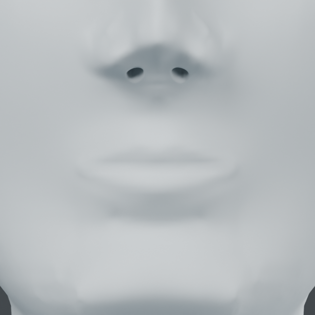
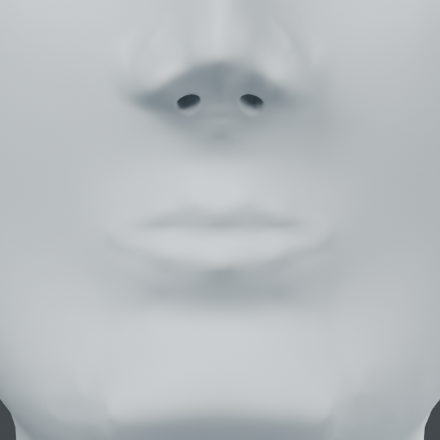
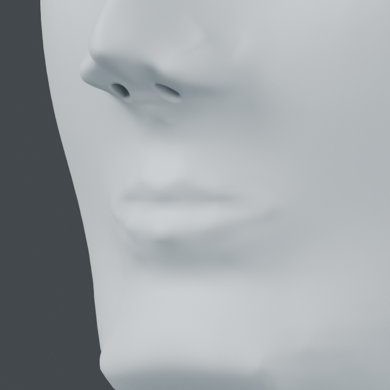

# Registered oral relief

This pass addresses weak lip volumes and the lip/skin transitions on the current
procedural character. It preserves the existing eye and nasal work.

## Relationship evidence and authored controls

[NIH oral-region anatomy](https://elementsofmorphology.nih.gov/anatomy-oral.shtml)
describes the commissures joining the upper/lower vermilion, Cupid's bow peaks at
the bases of the philtral pillars, the central philtral groove and the lower
mentolabial boundary. These are qualitative relationships. No source images,
population dimensions or numerical proportions are copied.

`anatomy_fit.compile_oral_relief(source, target)` reuses `oral-neutral-v1` and
its four manually registered landmarks. It generates 20 visible-surface controls
for `curve_fit.apply`. The mouth faces -Y, with Z up. Positive volume projects
toward -Y; the seam and lower fold recess toward +Y. Corners are pinned.

Default upper/lower displacement is 0.9/1.4 mm; seam recession 0.4 mm,
philtral pillar projection and central fold recession 0.3 mm. These are authored
increments on an existing model, not tissue thicknesses or anatomy measurements.
The input registration remains necessary on each different face.

`curve_fit` now accepts optional `surface_interpolation: true`. Its solve uses
barycentric samples of actual mesh triangles rather than only the continuous
kernel evaluated at each control. This addresses target error when a control
lies between vertices. Existing callers keep their previous default behavior.
Polygon reversal/collapse and displacement limits remain enforced.

## Reproduce

Run `examples/human/mouth/refine.py` inside factory-startup background Blender,
with two CPU/numerical threads. Arguments are the input
`runs/human/supported-eyelids-collar/supported-lids.blend` and a fresh output folder.
Current native: `runs/human/oral-relief/oral-relief.blend`.
The script includes registration, protection, rollback, invalid inputs, injected
late failure cleanup, saved-coordinate readback and matched source/result views.

## Evidence and limits

Blender 5.2.2 LTS: 20 controls, 617 moved vertices, maximum movement 1.40372 mm.
81,668 region-protected vertices and 15,258 vertices at/above the nose/eye
protection height remain unchanged. Source and topology preservation, reversible
layer, four invalid inputs and injected late failure cleanup pass.
Maximum target surface distance is 0.02252 mm; the initial continuous-field solve
missed by 0.25589 mm and was corrected without relaxing the 0.2 mm check.
Minimum changed polygon area ratio is 0.90667. This is not a collision proof.

The native was reopened and its coordinates checked before four matched
640px/16-sample source/result renders. Both directions were inspected: lip volume
is more distinct, but the philtral termination and lower fold still look coarse.
The input file hash is unchanged and Blender exited.

| Before | Current front |
| --- | --- |
|  |  |

The result is a static closed-mouth surface relief. There is no actual oral
opening, mucosa, teeth, muscle model or anatomical validation. Chin silhouette
and the full face stage remain unfinished.

## Protected transition fairing

`anatomy_fit.compile_oral_transitions(source, target)` returns a diagram and two
commands for `surface_brush.apply`. The same four visible-surface references are
required. Upper/lower region limits are derived from the Cupid's bow, lower-lip
and nose-base landmarks, leaving the vermilion band and nose unchanged.
Geodesic radii are authored fractions of mouth half-width; ten relaxation
iterations at strength 0.5 retain signed enclosed volume. This numerical volume
constraint does not represent tissue mechanics or anatomical correctness.

`surface_brush` also now rejects changed polygons that reverse orientation or
retain less than 15% of their previous area before writing a layer.

Reproduce with `examples/human/mouth/transitions.py`, input
`runs/human/oral-relief/oral-relief.blend`, and a fresh output folder. The script
reprojects the stored registration to the current visible skin.
Current native: `runs/human/oral-transitions/oral-transitions.blend`.
The previous source and its layers remain in the scene; the new object is an
evaluated snapshot with two reversible transition layers.

Blender 5.2.2 LTS: 63/200 changed vertices, maximum combined movement 0.86820 mm,
81,755 protected vertices and 988 unchanged lip-band vertices. Source/topology,
rollback, invalid second-stroke cleanup, injected finish failure, saved-native
coordinate readback and input-file hash pass. Stored per-stroke volume changes
are 0.000037/0.001172 mm3, below the existing 0.1 mm3 limit. Minimum changed
polygon area ratios are 0.59834/0.79306. Two CPU/numerical threads, one process,
two 640px/16-sample saved-model renders; Blender exited.

| Previous oral relief | Current transition |
| --- | --- |
|  |  |

Visual review: the lower-fold transition is slightly softer. This is a small
local fairing pass; the broad angular chin and jaw/cheek transition still need
silhouette work. The oral opening and interior remain unimplemented.
