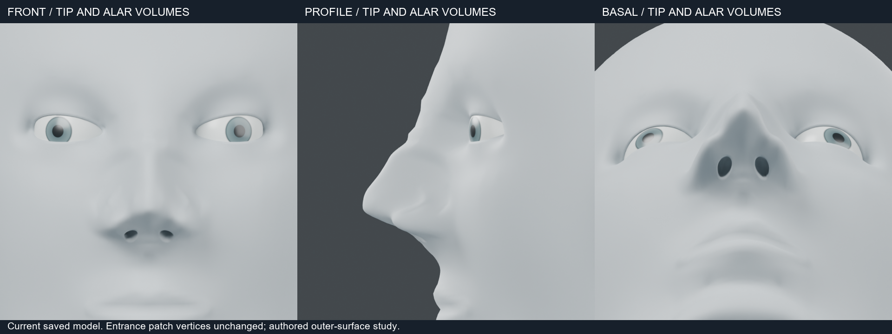
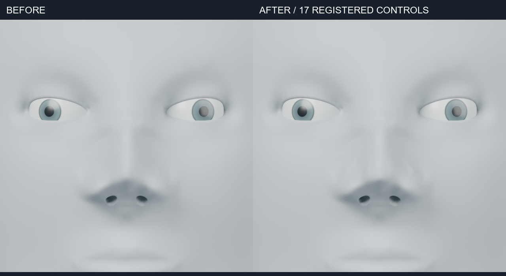

# 코끝·콧날개 외형 조정 — 2026-10-24

코끝 중앙의 돌출을 줄이고 양옆에 볼륨을 더하는 17개 표면 제어점을 적용했습니다.
콧날개 위쪽은 약하게 돌출시키고 볼 부착부는 고정 또는 소폭 후퇴시켰습니다.
큰 재형성이 아니라 외형의 완만한 조정입니다. 연골 형상이나 개인별 해부 정확도를 검증한 결과는 아닙니다.

## 보호와 적용

기존 `nasal_entrance` 결과와 그 원본의 정점 좌표를 비교해 입구 생성·완화로 달라진 1,372개 정점을 식별했습니다.
그 정점들의 최고 높이보다 위에서만 변형을 시작하도록 영역을 제한했습니다.
입구 연결부의 이동량은 정확히 0이며 토폴로지를 유지했습니다.
원본은 별도 객체로 남기고 새 객체의 `MW tip and alar volumes` 레이어에 변형을 저장했습니다.
레이어를 끄면 이전 형상으로 복귀합니다.

`curve_fit`에 선택적인 `diagram.label`을 추가했습니다. 기존 기본 이름은 유지합니다.
실제 제어점과 목표 좌표는 실행 폴더의 `diagram.json`에 기록합니다.

## 검증

- Blender 5.2.2 LTS에서 최대 이동 1.44309mm, 변경 정점 2,782개를 확인했습니다.
- 영역 밖 78,004개 정점은 보호됩니다. 입구 정점 1,372개의 동일성을 별도로 확인했습니다.
- 원본·토폴로지 보존, 레이어 복귀, 잘못된 레이어 이름 거부를 확인했습니다.
- 저장한 native를 같은 프로세스에서 다시 열어 결과 정점의 동일성을 확인했습니다.
- 정면·측면·아래쪽 사선 렌더는 640px/16샘플입니다. Blender와 수치 라이브러리는 2스레드로 제한했습니다.

현재 native: `runs/human/tip-ala-refined/tip-ala.blend`입니다.
재현: `examples/human/nose/refine/tip_ala.py`에 기존 `nasal-entrances.blend`와 새 출력 폴더를 전달합니다.
비교판: `examples/human/nose/refine/board.py`입니다.

코끝의 변화는 제한적이며 콧날개 하부는 입구 보호 때문에 이번에 조정하지 않았습니다.
입구가 규칙적인 형태인 점과 얼굴 전체의 거친 조형은 남아 있습니다.
