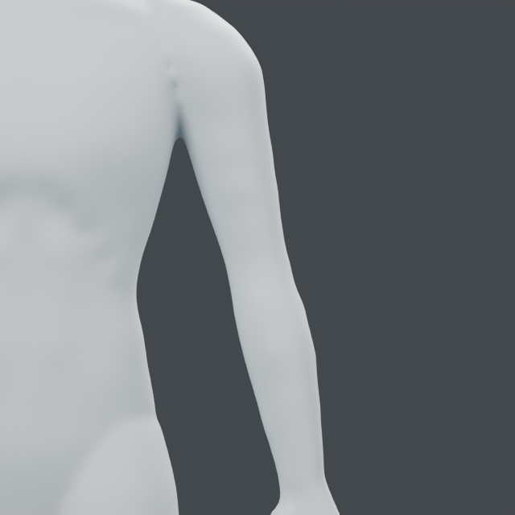
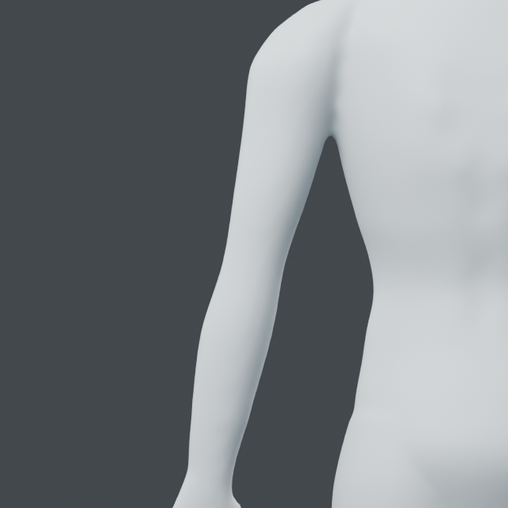
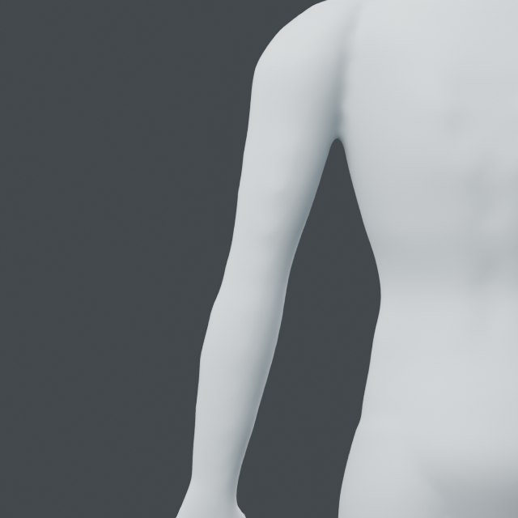

# Registered upper-arm and forearm skin controls

Stage D is in progress. The saved model has broad arm volumes; elbow bony
landmarks and hand/finger structure remain insufficient. This pass adds 24
controls per side and an atomic bilateral application tool.

## Relationships and registration

[OpenStax upper-limb muscles](https://openstax.org/books/anatomy-and-physiology-2e/pages/11-5-muscles-of-the-pectoral-girdle-and-upper-limbs)
supports anterior upper-arm flexor versus posterior extensor relationships and
anterior/posterior forearm compartments. No images or anatomical measurements
are copied. `arm-surface-v1` records these relationships separately from authored
stations and depths. It does not segment individual muscles or infer joints.

`from mesh_workbench.regions import arm`

`compile_controls(source, target)` requires side -1/+1, descending manual
interior `proximal`, `elbow`, `wrist` XYZ axes, and a protected box. This profile
expects upright hanging arms, front -Y/up Z. Outward ray exits locate front,
back and lateral skin. Exit normal and distance reject unsuitable axes.
`apply_pair(source, targets, name)` compiles both registrations before mutation,
rejects overlapping boxes and creates two reversible layers on a new snapshot.
Any failed second application removes the first snapshot; the original remains.
No automatic anatomical registration, arbitrary poses or production rig claim.

## Actual-model evidence

`examples/human/arms/audit.py` records arm sections and two views. At Z=1.14 m
the source front/back depths are -0.02563/+0.04951 m. The 1.30 m inner probe is
invalid because the cropped surface starts inside the arm; it is not used as an
inner measurement. The centerline coordinates come from the included source
construction and are explicitly registered, not discovered from anatomy.

`examples/human/arms/relief.py` applies the controls to the preserved
`runs/human/flank-transition/flank-transition.blend` into a fresh output folder.
Current native: `runs/human/arm-relief/arm-relief.blend`, object `Arm relief study`.
Blender 5.2.2 LTS: 48 controls, 7,012 changed vertices, maximum move 3.08106 mm,
maximum target-surface residual 0.00565 mm. 83,233 outside-box vertices exact;
minimum changed polygon area ratio 0.97891. Source/topology/rollback, invalid
registration, injected second-arm failure cleanup, saved readback and input
SHA pass. One Blender process, two threads; exited. Diagram/report are adjacent.

Both front/back comparisons show modest volume changes. The elbow remains
rounded, the shoulder junction is simple, and no detailed muscles or tendons
are established. Next: elbow surface landmarks and transitions, with existing
body and hand protection. Stage D and the full goal remain active.

| View | Before | After |
| --- | --- | --- |
| Front |  |  |
| Back |  |  |
