# Five-digit hand stock, not yet grafted

The actual source hand is a mitten-like block with a thumb bulge. The read-only
`examples/human/hands/audit.py` records wrist/palm sections and front/back views.
At Z=0.90 m front/back thickness is about 54.35 mm; at Z=0.845 m it is 49.10 mm.
No distinct fingers exist in that source. Local relief cannot establish their
separation, so topology construction precedes further palm brushing.

## Reusable construction

`from mesh_workbench.regions import hand`

`hand.build(name, scale=1, side=1)` returns a separate closed hand and preserved
construction stocks. Palm, thumb and four finger stocks use cubic section
interpolation and local 1 mm voxel fusion (scaled with the hand). The source
character is never modified. Late fusion failure removes every created object
and orphan mesh. Scale is bounded to 0.7..1.4; only the default scale/side was
validated on this pass. This is not cross-character reuse evidence.

`hand-structure-v1` separates authored widths, lengths and skin stations from
[OpenStax hand bone relationships](https://openstax.org/books/anatomy-and-physiology-2e/pages/8-2-bones-of-the-upper-limb):
five metacarpal rays, two thumb phalanges and three for each other digit.
No artwork, measured proportions, internal bones or automatic joint recognition.

`examples/human/hands/build.py` takes the preserved elbow-relief native and a
fresh output folder. Current separate prototype:
`runs/human/hand-stock-curved/hand-stock.blend`, object `Hand stock`.
The authoritative integrated character is still
`runs/human/elbow-relief/elbow-relief.blend`.

## Evidence and next action

Blender 5.2.2 LTS: 39,378 vertices, one connected closed consistently oriented
surface, three empty finger-gap rays and four occupied digit rays at Z=0.79 m.
These are section-specific gap checks, not a global collision guarantee.
Invalid scale rejection, injected fusion failure cleanup, original geometry,
input SHA and saved-native coordinate readback pass. Two actual result views
inspected, one process/two threads, exited. Reports are alongside the prototype.
An initial test-index error was corrected; a cubic-section revision softened
some linear edges. The palm remains slab-like, fingertips are blunt and the
finger web edge is too straight. No nails, detailed creases, tendons or rig.

Next: improve palm/web shape and establish an explicit wrist-boundary graft on
a new body snapshot. Current hand has a closed proximal cap and is NOT attached.
Wrist-boundary preservation and bilateral integration have not been achieved.
Stage D and the full goal remain active.

Source character hand:

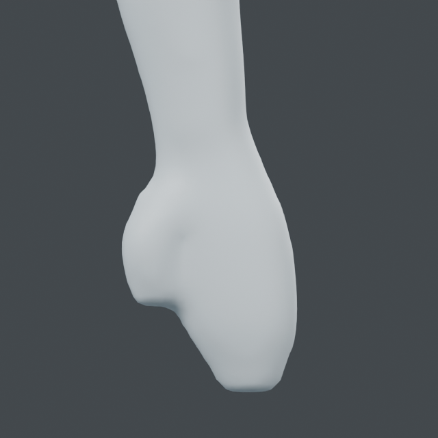

Separate procedural stock:

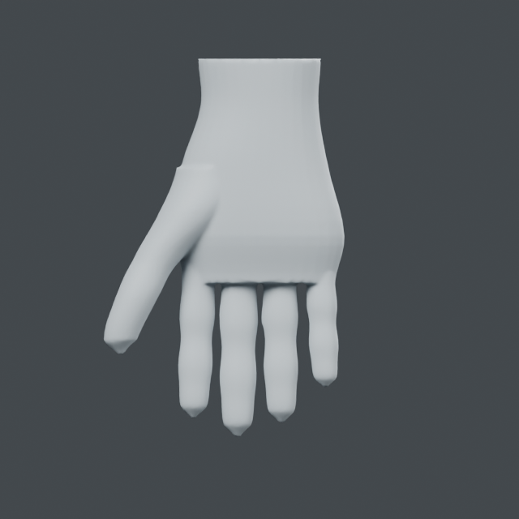
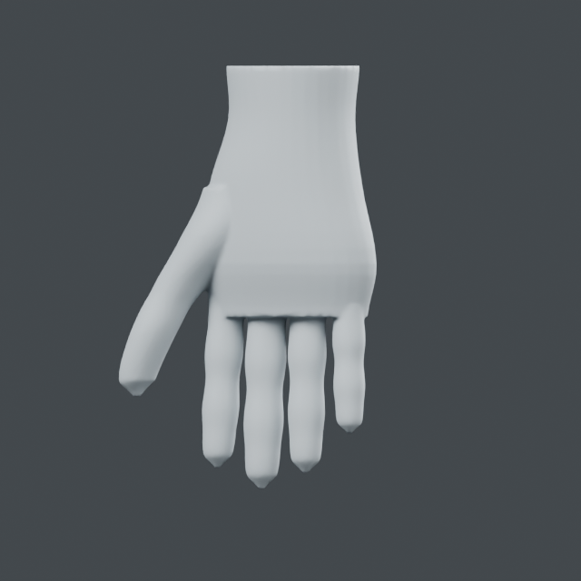

## Bilateral wrist graft

`regions.graft.replace_hand(source, stock, side, name)` creates a new topology
snapshot. It removes bounded distal-hand faces, requires one simple boundary
per mesh, orders the loops, and joins them with an arc-length zipper of triangles.
Existing retained vertices are copied exactly. Inputs, layers and topology-bound
selections remain on the original; none are falsely transferred to new topology.
This is a restricted upright hand graft (world X side threshold .24 m), not an
arbitrary mesh replacement API. Opposing sides are applied as explicit snapshots;
the example does not promise a single atomic transaction across both grafts.

`examples/human/hands/attach.py` takes the preserved elbow native and a fresh
output folder. Current integrated native:
`runs/human/hands-grafted/hands-grafted.blend`, object `Hands grafted study`.
Both generated hands are offset/sheared to the existing wrist axes. Original
body, hand stocks and the intermediate left-hand snapshot remain preserved.

Blender 5.2.2 LTS: each seam connects 34 body boundary vertices to 184 stock
boundary vertices using 218 triangles. Left operation retains 90,148 vertices;
right retains 122,533 of its input, including the new left hand. All retained
positions are exact; 59,731 original vertices above Z=.912 survive exactly.
Closed/oriented edge checks, noncollapsed seam triangles, invalid-cut rejection,
injected late-failure cleanup, original topology/geometry, new snapshot free of
stale shape keys/groups, native readback and input hash pass. No global seam
intersection test or generalized graft claim.

Front/oblique integrated views were inspected. A cuff-like wrist band, flat
palm/web and blunt fingertips remain; next is local seam/palm shaping while
preserving finger gaps. Stage D remains incomplete.
An initial example hid unrelated meshes. The script now changes only original,
intermediate and generated stock visibility. `check_visibility.py` restored the
second eye and studio floor from the original and verified final readback with
unchanged graft coordinates. Hand closeups precede that unrelated visibility
restoration. One process/two threads throughout, exited.

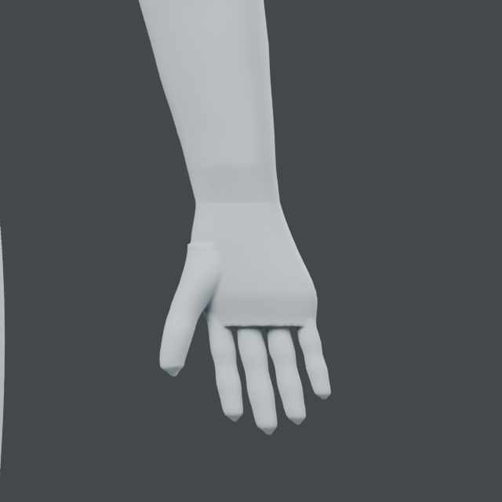
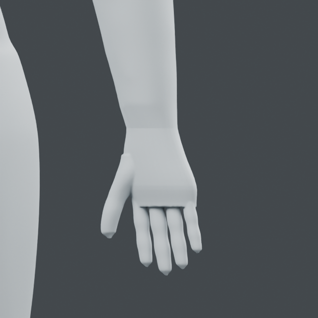

## Wrist fairing rejection and stock vertex weld

The wrist band is not fixed. Uniform surface relaxation exceeded its unchanged
3 mm cap. An experimental inverse-length neighbor weighting with reduced
strength then failed polygon orientation at face 122586; it was not retained
in the library. That face had edges 21.10135, 0.0008643 and 21.10122 mm, a ratio
of about 24,415. `examples/human/hands/wrist.py` reproduces the uniform rejection
on the earlier hands-grafted native, checks no source mutation or leaked objects,
and records that suspect face. It is a rejection audit, not a successful brush.
The inverse-length experiment is only retained in ignored local runs.

`graft.replace_hand` now welds stock-only vertices within 0.01 mm, after mesh
construction and before orientation checks. No retained body vertex is included
in the weld. Both hands merged 50 stock vertices. The report's 218 seam triangles
are the pre-weld candidate triangles, not a post-weld count.
Blender 5.2.2 LTS: exact retained vertices, 59,731 original above-wrist points,
source/topology, closed/oriented edges, invalid cuts, late-failure cleanup,
native readback and input hash pass. Latest native:
`runs/human/hands-grafted-welded/hands-grafted.blend`.
Two actual views inspected, one process/two threads, exited.

A subsequent low-strength uniform relaxation on the welded model still exceeded
the 3 mm cap; it produced no result native. The remaining large density mismatch
and long bridge triangles require intermediate wrist sections before further
fairing. Do not raise caps or weaken polygon guards. Finger/palm refinement and
stage D remain unfinished.

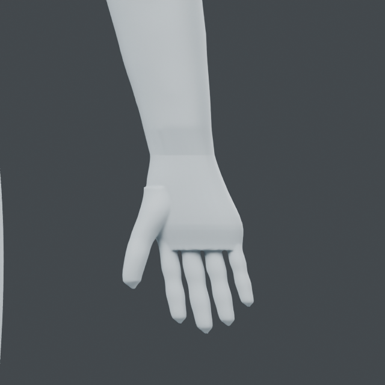
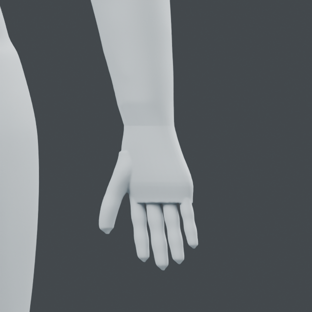

## Intermediate wrist sections and successful fairing

`graft.replace_hand` now inserts four 64-vertex rings. It samples the existing
boundary loops, measures nearby radial sections 8 mm above/below them and uses
cubic Hermite interpolation to carry the local slope across the gap. Boundary
vertices remain unchanged during reconstruction. Interior-origin/exit-normal,
height and degenerate-triangle guards reject unsupported configurations.
Source-specific upright wrist limitations remain; this is not arbitrary grafting.

Each seam has 730 pre-weld candidate triangles. Fifty near-coincident stock
vertices per side are still merged without merging retained body vertices.
`attach.py` verifies exact retention, original topology/geometry, closed oriented
edges, invalid cuts, injected late failure cleanup, native readback and hash.
Reconstructed native: `runs/human/hands-ring-bridge/hands-grafted.blend`.

`examples/human/hands/fair_wrist.py` then applies four existing uniform-neighbor
volume-preserving strokes, radius 20 mm, strength 0.12, three iterations, unchanged
3 mm cap. The same low-strength setting rejected on the long-triangle bridge
now passes. No brush algorithm, cap or polygon guard was relaxed.
Blender 5.2.2 LTS: maximum move 0.48410 mm, 149,715 protected vertices exact;
source/topology, layer rollback, exact invalid-second-mode rejection, injected
finish-failure cleanup, stored-volume checks, native readback and input hash pass.
Finger vertices below Z=.875 are outside all edit boxes and remain exact.

Current integrated native: `runs/human/wrist-ring-faired/wrist-transitions.blend`,
object `Wrist transition study`. The reconstructed boundaries are preserved on
the input snapshot; subsequent local motion is reversible. Two matched views
inspected; one process/two threads throughout, exited. A broad wrist contour
remains, while the brush-blocking topology problem is resolved for this operation.
Palm/web slab shape and blunt fingertips remain; next is palm/web shaping.
Stage D and full goal remain active.

Reconstructed whole-hand view:

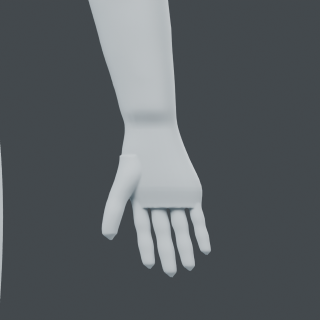

| Fairing view | Before | After |
| --- | --- | --- |
| Front | 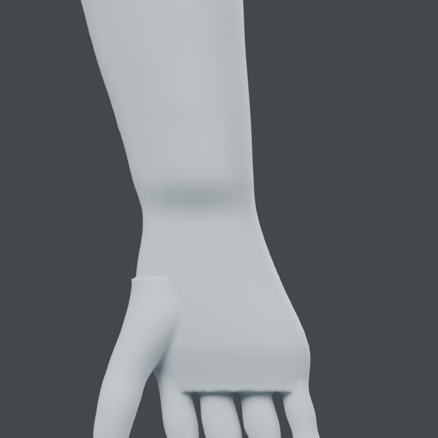 |  |
| Oblique | 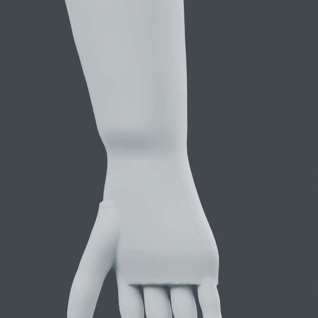 | 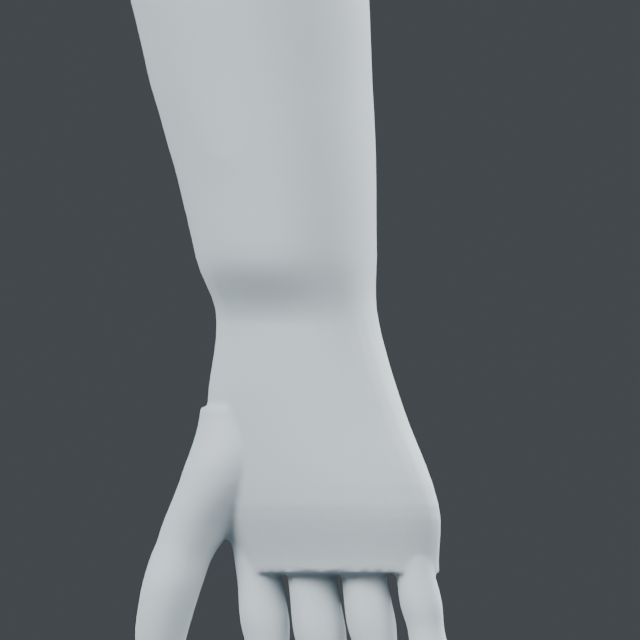 |

## Registered palm cupping and web arch

`hand.compile_palm(source, side, center_x)` emits 40 source-projected front/back
controls in the current upright hand frame. `hand.apply_palms(source, centers)`
precompiles both sides and applies reversible layers atomically, cleaning the
first output if the second fails. It retains the original geometry and layers.
Offsets establish a shallow palm hollow and vary the web start height toward
the little finger; these are authored skin offsets, not measured bone positions.
Fixed Z levels, front -Y, and side/center requirements limit this registration.
It is not automatic anatomy fitting or arbitrary hand-pose support.

`examples/human/hands/palm.py` takes the preserved wrist-ring-faired native and
a fresh output folder. Current native: `runs/human/palm-shaped/palm-shaped.blend`,
object `Palm shaped study`. Blender 5.2.2 LTS: 80 controls, max move 5.06327 mm,
maximum target residual 0.00352 mm; minimum changed polygon area ratio 0.69192.
115,253 vertices outside the two palm boxes are exact. All finger vertices below
Z=.800 and wrist vertices above Z=.878 are protected; six gap rays at Z=.79
remain empty. This is a section check, not a global collision guarantee.
Source/topology, layer rollback, invalid side/center rejection, injected second
hand cleanup, saved readback and input hash pass. One process/two threads, exited.

Front/oblique comparisons show a curved rather than straight web start, with a
small palm-depth change. Thumb-root step and planar palm surfaces remain visible.
Next is thumb-root/palm transition shaping; fingertips and detailed joints remain
unfinished. Stage D/full goal remain active.

| View | Before | After |
| --- | --- | --- |
| Front | 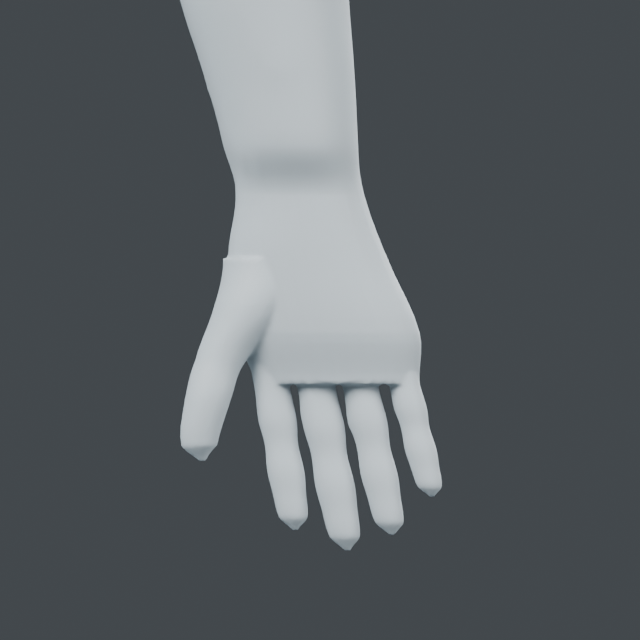 |  |
| Oblique |  |  |

## Registered thumb/palm fairing paths

`hand.compile_transitions(source, centers)` creates eight source-projected
paths: thumb-root and palm transitions on front/back of each hand. Existing
`surface_brush.apply` supplies reversible volume-preserving layers and atomic
failure cleanup. Fixed upright registration and authored path/radius settings
remain limitations; this is a surface fairing tool, not anatomy inference.
Radius 12/18 mm, strength .5, ten iterations, unchanged 3 mm cap.

`examples/human/hands/transitions.py` takes palm-shaped native and a fresh output
folder. Current native: `runs/human/hand-transitions/hand-transitions.blend`,
object `Hand transition study`. Blender 5.2.2 LTS: maximum move .56541 mm,
118,239 outside-box vertices exact. Source/topology, all-layer rollback, exact
invalid-second-mode rejection, injected finish-failure cleanup, stored-volume,
native readback and input hash pass. Vertices below Z=.812 and above Z=.883
remain outside every region. Existing fingers and wrists are protected.
One process, at most two numerical/CPU threads; exited.

Matched front/oblique renders show only small local rounding. The visible upper
thumb-root silhouette step remains; front/back fairing does not sufficiently
control that medial outline. Next: register the medial thumb-root outline and
shape its continuity directly, rather than repeating this smoothing pass.
Flat palm areas, blunt fingertips and simplified joints remain. Stage D active.

| View | Before | After |
| --- | --- | --- |
| Front |  | 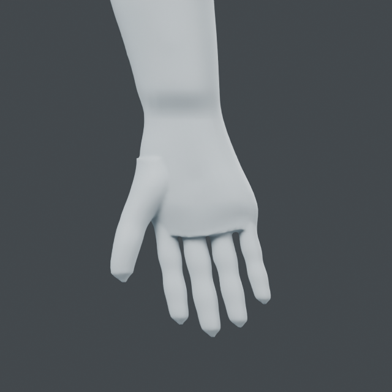 |
| Oblique |  |  |

## Medial thumb section fitting

`hand.compile_thumb_outline(source, side, center_x)` samples nine medial surface
points at each of Y=-.012/0/.012 m, Z=.850.. .890 m. Endpoint-preserving cubic
least squares replaces local step-like deviations. Interior-exit checks and a
3 mm fit cap reject unsuitable data. `apply_palms(..., profile="thumb")` reuses
the bilateral transaction and adds two reversible layers. This is measured skin
continuity, not anatomical landmark recognition; the fixed frame remains limited.

`examples/human/hands/thumb.py` takes hand-transitions native and a fresh folder.
Current native: `runs/human/thumb-outline/thumb-outline.blend`, object
`Thumb outline study`. Blender 5.2.2 LTS: 54 controls, max move 1.37255 mm,
residual .00718 mm, minimum changed polygon area ratio .73547, 137,360 outside
vertices exact. Source/topology, rollback, invalid side, second-side failure
cleanup, six gap rays, saved readback and input hash pass.

All six actual surface sections have a lower maximum absolute second difference
at 5 mm sampling. Worst recorded section decreases from 4.53299 to 1.68166 mm;
this is a discrete contour metric, not physical curvature or anatomy accuracy.
Two matched views inspected. A small upper silhouette notch remains, especially
in oblique view; no claim of complete step removal. Next: blunt fingertips and
finger joint contours. Palm planar areas and residual thumb notch remain on the
integrated review list. Stage D active; one process/two threads, exited.

| View | Before | After |
| --- | --- | --- |
| Front |  |  |
| Oblique |  |  |

## Finger section controls - 2026-10-24

Added `hand.compile_fingers` and atomic `apply_palms(profile="fingers")`.
80 controls per hand register four distal radial sections and two palmar/dorsal
joint stations on the included upright stock. Local 4 mm kernels add up to
.45 mm skin relief. Interior-exit/radius guards reject unsuitable registration.
This is authored skin shaping, not bone detection or anatomical validation.

Blender 5.2.2 LTS: 160 controls, max move .49384 mm, surface residual .02037 mm,
minimum polygon area ratio .88543. 131,067 outside-box vertices and 7,028 thumb
region vertices unchanged. Source/topology/rollback/invalid registration/
second-hand cleanup/six gap rays/native readback/input hash pass.
Actual front and oblique views show small distal-width changes. Angular terminal
caps, planar palm and a thumb-root notch remain. Next: terminal-cap silhouette,
then bounded hand-stage review. Stage D active. One process/two threads, exited.

Current native: `runs/human/finger-contours/finger-contours.blend`, object
`Finger contour study`. Example: `examples/human/hands/fingers.py` takes the
thumb-outline native and a fresh output folder.

| View | Before | After |
| --- | --- | --- |
| Front |  | 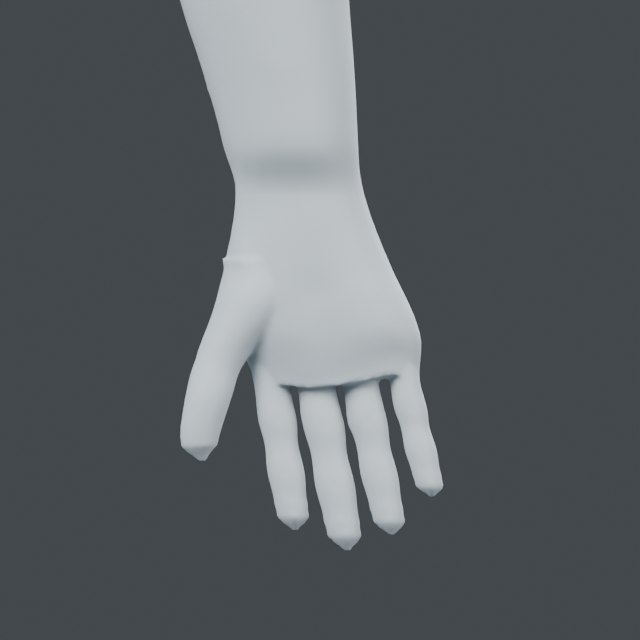 |
| Oblique |  |  |

## Rounded fingertip caps - 2026-10-24

`hand.compile_caps` registers five radial sections per non-thumb digit against
an authored elliptical skin cap. `apply_palms(profile="caps")` applies two
reversible layers atomically. The top section stays at its source diameter.
All vertex Z coordinates remain exactly unchanged: finger length is preserved.
This fixed stock-frame tool does not detect bones or model nails.

Blender 5.2.2 LTS: 160 controls, max move 2.02035 mm, surface residual .01725 mm,
minimum changed polygon area ratio .77927. 142,399 outside-region vertices and
7,028 thumb-region vertices unchanged. Source/topology/rollback/invalid side/
second-hand failure cleanup/six gap rays/native readback/input hash pass.
Front and oblique renders confirm rounder ends. Some distal flaring, planar
palm, simple joint relief and a small thumb-root notch remain.

Native: `runs/human/rounded-caps/rounded-caps.blend`, object `Rounded fingertip study`.
Example: `examples/human/hands/caps/run.py` takes finger-contours native and a
fresh output folder. Uses the shared hand verification/render runner.
One Blender process/two threads, exited. Next is bounded stage-D handoff review
against existing arm/hand evidence, then pelvis/legs/feet. The overall goal is active.

| View | Before | After |
| --- | --- | --- |
| Front |  |  |
| Oblique |  | 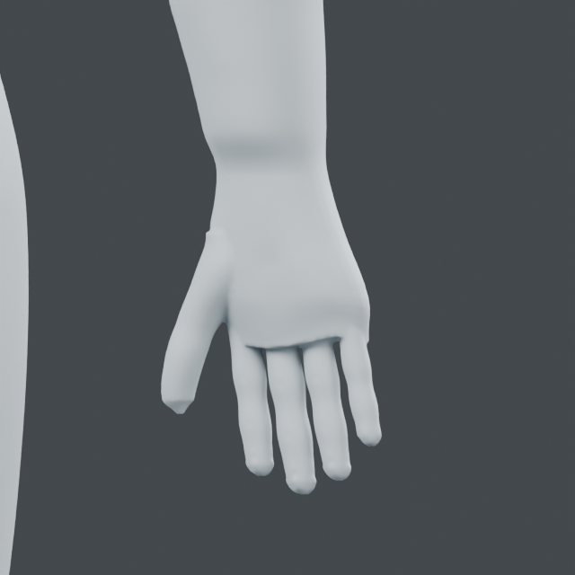 |

## Stage-D handoff review - 2026-10-24

Reviewed existing verification JSON and corresponding assertion paths in arm,
elbow, attachment and hand examples. No rerun of passed geometry checks.

| Required capability | Recorded evidence |
| --- | --- |
| Upper/lower arm and elbow controls | arm-relief 48 controls, elbow-relief 40; source, rollback, outside-region, failure cleanup and saved readback pass |
| Connected separated digits | hands-ring-bridge closed oriented wrist seams, retained vertices exact; palm/finger/cap runs preserve six sampled finger gaps |
| Palm and joint-position controls | palm-shaped 80 controls; finger-contours 160 controls at authored distal/joint stations |
| Body protection and reversible edits | 59,731 above-wrist vertices retained in graft; deformation examples compare all outside-box coordinates and layer rollback |
| Actual stored geometry and views | each stage native readback; latest rounded-caps front and oblique views inspected |

The bounded static tool/application criteria of stage D are satisfied. This is
not anatomical correctness or a realistic finished hand: planar palm, shallow
joint relief, slight distal flaring, small thumb-root notch and simple elbow
remain. New-topology graft retains older layers/masks on the original snapshot,
not on the replacement topology. Gap rays are sampled clearance, not a global
collision proof. Full-body integration and reuse remain stages F/G.
Next is [stage E lower-limb work](LEGS.md).
