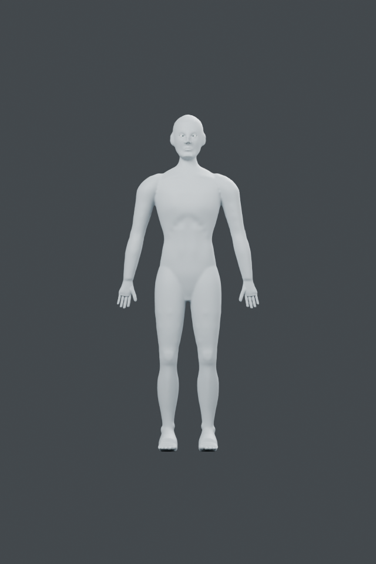
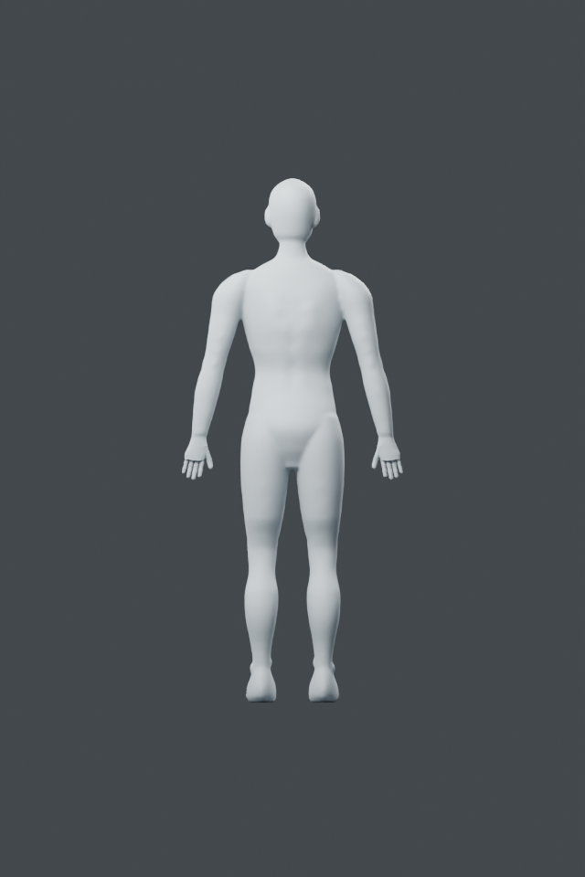
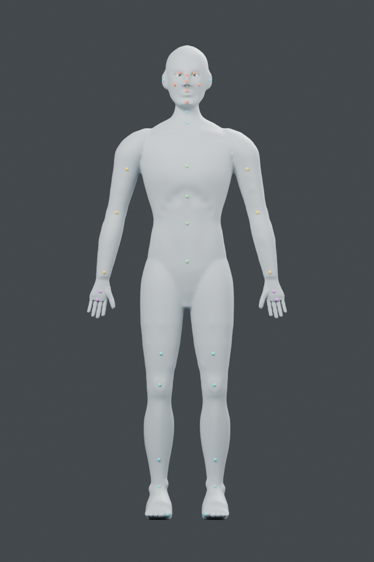
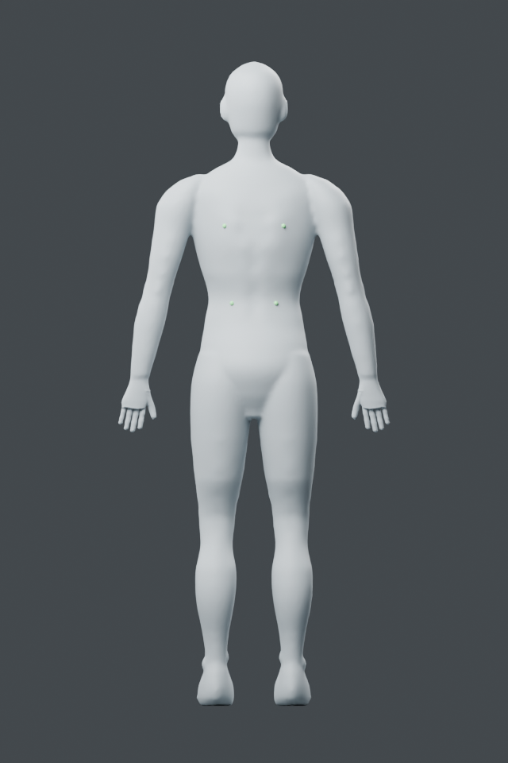

# Whole-character integration

## Grounded whole-character assembly - 2026-10-24

Added `assembly.ground(body, attachments, floor_z, name)`: copies an explicit
unparented mesh assembly into a new collection and applies one rigid vertical
translation. Source meshes/keys and the floor are preserved. Duplicate members,
existing collection, parented inputs and placement beyond 50 mm are rejected.
Failure removes new objects/meshes/collection.

Blender 5.2.2 LTS: current body and both eye globes shifted -7.871014 mm together;
relative positions and topology preserved. Left/right sole minima are .015010/0
mm above the studio floor, within .2 mm. Source/floor coordinates, duplicate
rejection, injected second-member failure cleanup, native readback and input
hash pass. This is lowest-point grounding, not full sole contact or pose solving.

Actual front/back full-character renders inspected. Face, ears/neck, torso,
limbs, separate digits and eye globes coexist in the saved assembly. Known
simplifications remain: rounded anatomy, shallow ear detail, hand/foot root
ridges and limited joint definition. No realistic anatomy or production rig claim.
Stage E's bounded static tool/application evidence is reviewed; F is active.
The saved assembly map records provenance and placement, not a complete merged
anatomical landmark diagram. That integration and stage-G reuse remain pending.

Current native: `runs/human/integrated/integrated.blend`, body
`Grounded character body`, plus two named attachments. `assembly.json` and
`verification.json` are adjacent. Example: `examples/human/integration/ground.py`
takes feet-tapered native and a fresh folder. One process/two threads, exited.

## Stage-E evidence handoff

| Required capability | Existing evidence inspected |
| --- | --- |
| Thigh/knee direction and transition | thigh-knee and knee-transition reports plus matched front/oblique views |
| Shin/calf profile | calf-continuous source protection, posterior probes and front/back views |
| Ankle/heel/instep/arch | foot-relief registered controls, sole protection and actual views |
| Toe divisions and connection | feet-tapered closed seams, eight gap rays, ten toe hits, retained points and views |
| Pelvis and original preservation | region outside-box checks and graft retention; original native hashes/readback |

Reviewed corresponding example assertions and reports; no passed regional checks
were repeated. These are bounded static modeling-tool criteria, not validated
human anatomy. F/G remain unfinished, including merged landmarks and reuse on
another face/body.

| Front | Back |
| --- | --- |
|  |  |

## Integrated registered surface guide - 2026-10-24

`assembly.guides.register(body, rows)` projects explicit external rays onto the
current skin, rejecting wrong-facing hits, misses, duplicate names and hits
outside registered bounds. Returns `landmarks`, local `regions`/feather and
named paths compatible with surface-brush inputs, plus source evidence and
registration rays. It never mutates geometry. Names are manually assigned skin
targets; they are not automatically detected or anatomically validated bones.

Blender 5.2.2 LTS: 40 markers across 17 local protection regions cover midface,
eyelid/cheek, ears/neck, front/back torso, arms/hands, legs/ankles and hallux.
Maximum surface residual .000134 mm. Original coordinates/hash unchanged;
injected final-ray miss leaves no scene mutation. Saved body and marker
coordinates read back. Actual front/back colored overlays inspected. The initial
white marker material was corrected and missing ear/toe entries added before
final capture; no additional geometry deformation was performed.

F's bounded saved-model/guide integration criteria are satisfied: the complete
assembly and this registered guide share the same native file. This overview
does not replace the detailed local oral/nasal/eyelid guides or validate anatomy.
Next is stage G: a different face/body and reuse with separate registration.
Full goal remains active. One Blender process/two threads, exited.

Annotated native: `runs/human/guided-complete/guided.blend`; guide JSON and
verification adjacent. Clean modeling source remains `runs/human/integrated/`.
`examples/human/integration/guides.py` takes integrated native plus fresh folder.

| Marker family | Color |
| --- | --- |
| Face | Orange |
| Ear/neck | Blue |
| Torso | Green |
| Arms | Yellow |
| Hands | Purple |
| Legs/feet | Cyan |

Guide points sit on the body; rendered spheres are visual markers only and
must not be included in deformation targets. Region boxes are local defaults,
not certified masks for every anatomy task. Re-register after changing shape.

| Front | Back |
| --- | --- |
|  |  |
