# Lower-limb registration and next controls

## Current source audit - 2026-10-24

Stage E starts from `runs/human/rounded-caps/rounded-caps.blend`, object
`Rounded fingertip study`. `examples/human/legs/audit.py` loads this saved
character without editing geometry. Twelve manually specified interior axes
produce 48 outward skin exits with normal and distance guards. The lower-thigh
midline ray is open; geometry and input SHA256 are unchanged. Blender 5.2.2 LTS,
one process/two threads. Output: `runs/human/lower-limb-audit/audit.json` and two
actual renders. No new native file or repeated arm/hand tests were needed.

Right-side distances from authored axis to visible skin, in millimetres:

| Section | Front | Back | Outer | Inner |
| --- | ---: | ---: | ---: | ---: |
| Thigh | 90.64 | 90.67 | 79.65 | 79.75 |
| Lower thigh | 73.43 | 73.15 | 63.54 | 63.42 |
| Knee | 56.42 | 47.26 | 46.54 | 47.19 |
| Calf | 66.12 | 59.25 | 54.36 | 54.40 |
| Shin | 38.70 | 38.40 | 34.59 | 34.51 |
| Ankle | 35.82 | 33.73 | 36.82 | 32.04 |

These are skin distances, not bone dimensions. The source axes come from
`examples/human/scripts/human_base.py`; they are not automatically detected.
Views show cylindrical thigh mass, button-like knee relief, broad calf volumes
and an undivided foot/toe block. No realistic lower limb claim.

## Source relationships and bounded sequence

[OpenStax lower-limb bones](https://openstax.org/books/anatomy-and-physiology-2e/pages/8-4-bones-of-the-lower-limb)
places the patella in front of the distal femur, the tibia medially and fibula
laterally. The tibial tuberosity and anterior border provide anterior shin
landmarks; the distal tibia/fibula form medial/lateral ankle prominences.
These relationships guide registration; authored skin depths remain separate.
No reference artwork is copied.

1. Thigh-to-knee: register proximal thigh, knee and proximal shin axes; separate
   knee central relief from medial/lateral transition and flatten the spherical
   knee appearance with bounded reversible controls. Protect pelvis above the
   region, calf/feet below it, the other limb and upper body.
2. Shin/calf: anterior crest versus posterior mass, without carving exposed bones.
3. Ankle/foot: ankle prominence ordering, heel/arch/forefoot, explicit toe divisions.
4. Review stage-E silhouette and connections from saved native views, then F/G.

Each implementation must verify registration rejection, atomic bilateral failure,
original/protected geometry, layer rollback, target surface and saved readback.
No whole-project regression or compatibility expansion is authorized.

| Front | Oblique |
| --- | --- |
| 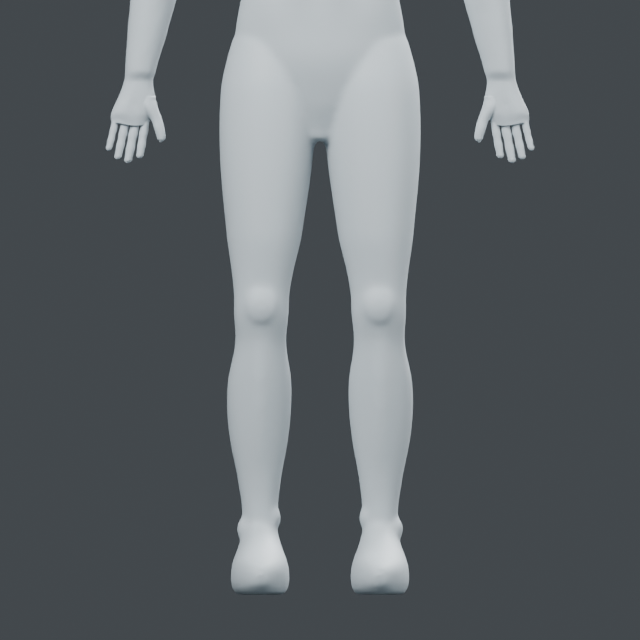 | 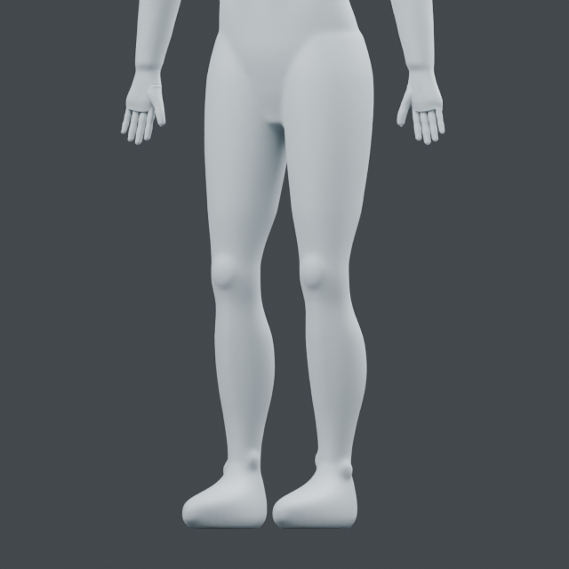 |

## Registered thigh-knee controls - 2026-10-24

`regions.leg.compile_controls(source, target)` accepts side and descending
manual proximal/knee/shin axes plus a protection box. Eight radial directions
at seven stations register visible skin through outward interior-exit checks.
`knowledge/body/leg-surface-v1.json` separates sourced anatomical relationships
from authored skin offsets. `leg.apply_pair` compiles both sides before editing,
rejects overlapping boxes, and removes partial snapshots on second-side failure.
Two reversible layers preserve the original. Fixed standing frame only.

Blender 5.2.2 LTS: 112 controls, max move 3.05306 mm, surface residual .00851 mm,
minimum changed polygon area ratio .94344. 144,789 outside-region vertices exact.
Original/topology/rollback/invalid axes/second-leg cleanup/saved readback/input
hash pass. Mid-thigh gap remains open. Actual front rays at the knee measure
2.99758 and 3.00252 mm less protrusion. Pelvis above Z=.79 m and calf/feet below
Z=.43 m are protected by the registered boxes.

Matched front/oblique views show modest lower-thigh contour and knee projection
changes. The spherical knee outline still reads clearly; this does not establish
an anatomical patella or finished leg. Next: local kneecap border/transition,
then shin/calf. Stage E remains active.

Native: `runs/human/thigh-knee/knee-relief.blend`, object `Thigh knee study`.
Example: `examples/human/legs/relief.py` takes rounded-caps native and a fresh
output folder. One Blender process/two threads, exited.

| View | Before | After |
| --- | --- | --- |
| Front | 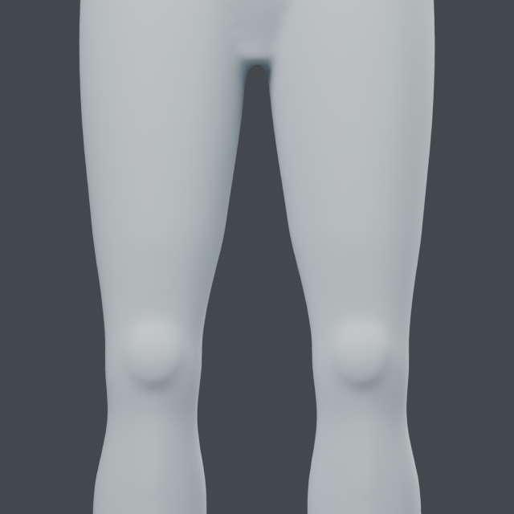 | 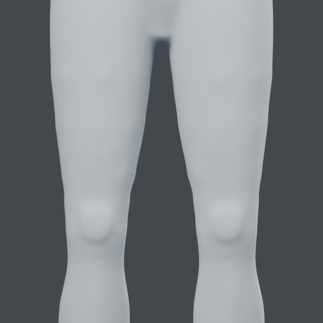 |
| Oblique | 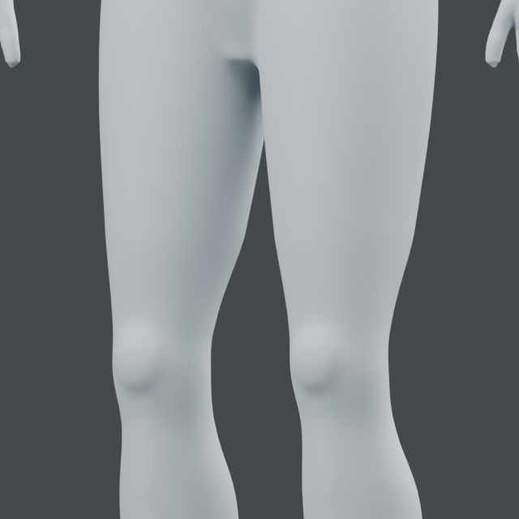 | 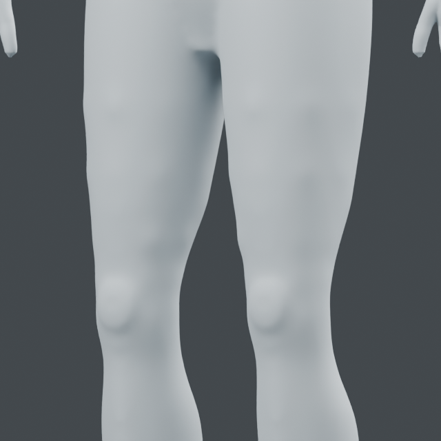 |

## Registered knee transition sections - 2026-10-24

`leg.compile_knee_transition` / `compile_controls(profile="knee_transition")`
register five anterior longitudinal sections per knee. Each has nine skin exits
with fixed endpoint samples. A 65 percent blend toward an endpoint-preserving
cubic fit reduces abrupt depth changes. This is skin continuity fitting, not a
reconstructed patella or anatomical outline inference. Existing bilateral
transaction and reversible layers remain in use.

Blender 5.2.2 LTS: 90 controls, max move 2.17455 mm, surface residual .07394 mm,
minimum changed polygon area ratio .89373. 152,943 outside-box vertices exact.
Original/topology/rollback/invalid axes/second-leg failure cleanup/thigh-gap/
native readback/input hash pass. All ten actual surface sections reduce their
maximum absolute second difference at 13.75 mm spacing; worst value across
sections 4.70793 -> 3.16853 mm. This discrete metric is not physical curvature.

Front and oblique saved-model comparisons show softer lower knee transitions.
A rounded knee outline and faint band below it remain; no realistic knee claim.
Next is shin/calf structure. Stage E and full goal remain active.
Native: `runs/human/knee-transition/knee-transition.blend`, object
`Knee transition study`. Example: `examples/human/legs/transition.py` takes the
thigh-knee native and a fresh folder. One Blender process/two threads, exited.

| View | Before | After |
| --- | --- | --- |
| Front |  | 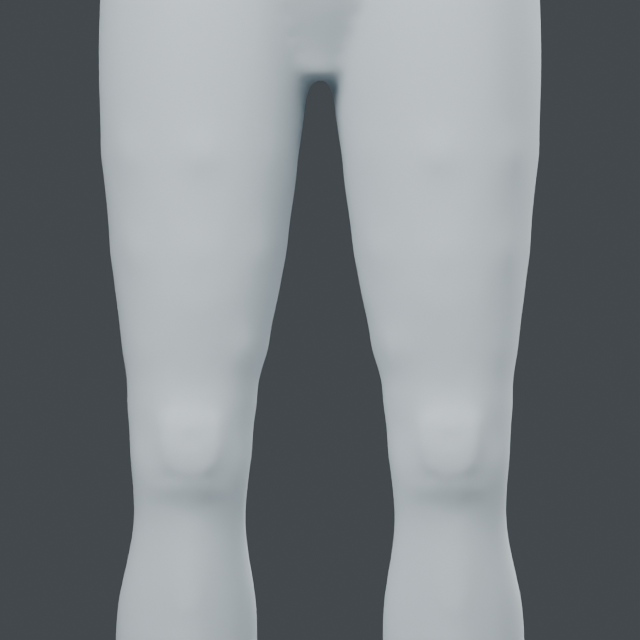 |
| Oblique |  |  |

## Registered shin/calf relief - 2026-10-24

`leg.compile_controls(profile="calf")` uses descending manual knee/calf/ankle
interior axes, seven radial stations and eight directions per station. The
knowledge file separates sourced anterior/posterior compartment relationships
from authored skin depths. Same atomic bilateral API and reversible layers.
The calf profile uses a 75 mm kernel; other profiles retain their prior radii.

Blender 5.2.2 LTS: 112 controls, max move 3.03012 mm, surface residual .01321 mm,
minimum polygon area ratio .96239. 149,224 outside-box vertices exact. Original,
topology, rollback, invalid axes, second-leg cleanup, sampled thigh gap, native
readback and source hash pass. Posterior calf probes expand by 1.99765/1.99759 mm.
Region Z=.135.. .438 m protects the knee and distal ankle/foot beyond those bounds.

The first 45 mm kernel produced visible station bands despite numeric checks;
that candidate remains in ignored `runs/human/calf-relief/` and was not selected.
The 75 mm correction was rechecked because of this concrete visual defect.
Matched front/back views show smoother continuity. Relief is shallow and muscles
remain simplified; this is not anatomical segmentation or a finished leg.
Next: ankle prominences and heel/instep transitions. Stage E remains active.

Current native: `runs/human/calf-continuous/calf-relief.blend`, object
`Calf relief study`. `examples/human/legs/calf.py` takes knee-transition native
and a fresh output folder. One Blender process/two threads at a time; exited.

[OpenStax lower-limb muscles](https://openstax.org/books/anatomy-and-physiology/pages/11-6-appendicular-muscles-of-the-pelvic-girdle-and-lower-limbs)
supports the anterior tibialis-anterior versus posterior gastrocnemius/soleus
relationship recorded in the knowledge file. Depths and station fractions are
authored modeling parameters, not copied anatomical measurements.

| View | Before | After |
| --- | --- | --- |
| Front | 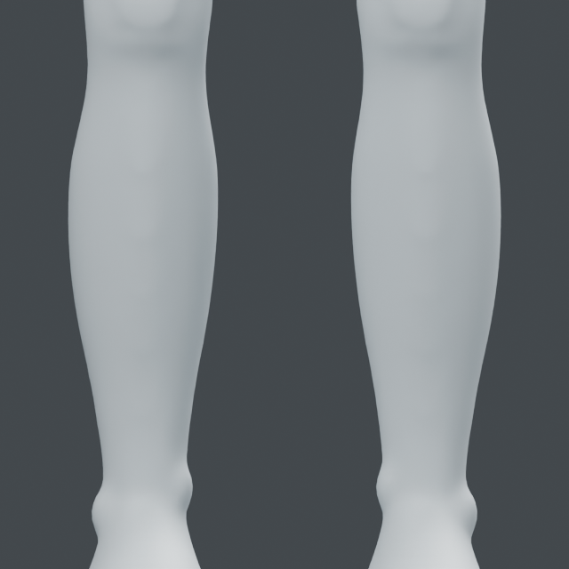 | 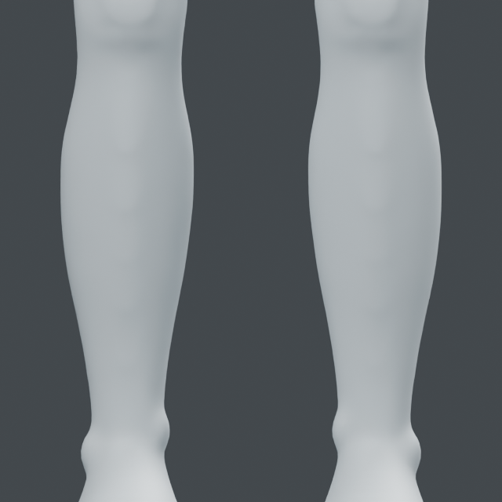 |
| Back | 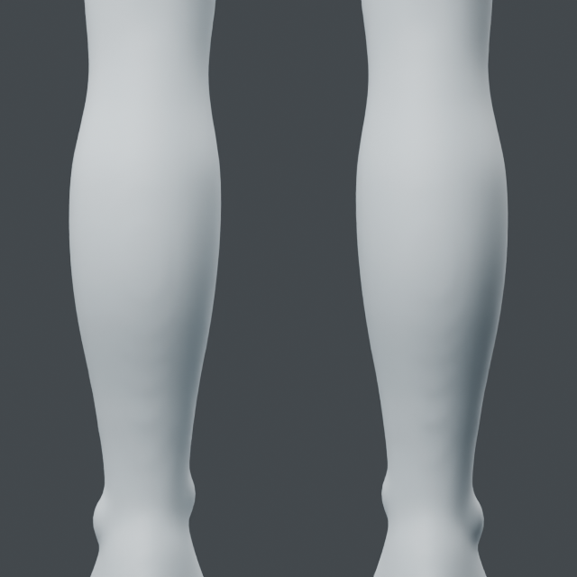 | 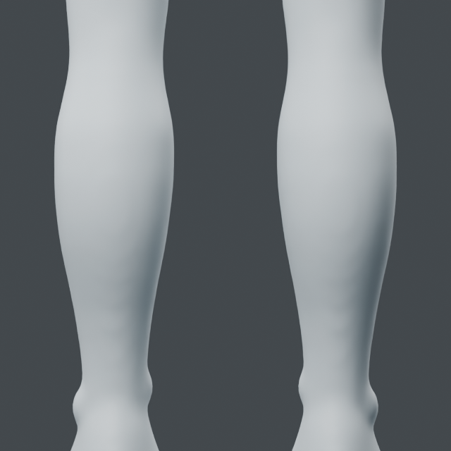 |

## Registered ankle/foot skin controls - 2026-10-24

`leg.compile_foot` / `compile_controls(profile="foot")` projects 31 skin controls
per foot from a manual ankle anchor. `knowledge/body/foot-surface-v1.json`
records ankle prominence, heel, instep and medial arch relations separately from
authored offsets. Outward-exit guards, bilateral precompilation/atomic cleanup,
35 mm kernels and reversible layers preserve the input.

Blender 5.2.2 LTS: 62 controls, max move 3.18622 mm, surface residual .04478 mm,
minimum polygon area ratio .90743. 150,019 outside-box vertices and 190 low sole
vertices unchanged. Original/topology/rollback/invalid side anchor/second-leg
cleanup/sampled thigh gap/native readback/input hash pass. Medial arch probes
move inward 3.00013/2.99986 mm. Sole protection is coordinate preservation,
not proof of floor contact or biomechanical correctness.

Matched front/oblique views show small ankle/instep changes. The toe block remains
undivided and a floor gap remains. No anatomical foot completion claim. Next:
five-toe structure with preserved heel/ankle; grounding remains for integration.
Stage E and the full goal remain active.

Current native: `runs/human/foot-relief/foot-relief.blend`, object `Foot relief study`.
`examples/human/legs/foot.py` takes calf-continuous native and a fresh folder.
One Blender process/two threads, exited.

The foot knowledge file uses the [OpenStax lower-limb bones](https://openstax.org/books/anatomy-and-physiology-2e/pages/8-4-bones-of-the-lower-limb)
relationships already recorded above. No source artwork or measured dimensions
are included. Surface anchors are manually placed on this standing model.

| View | Before | After |
| --- | --- | --- |
| Front | 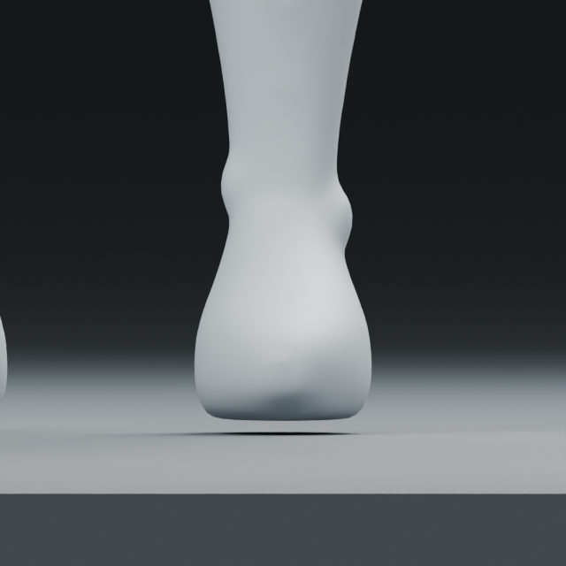 | 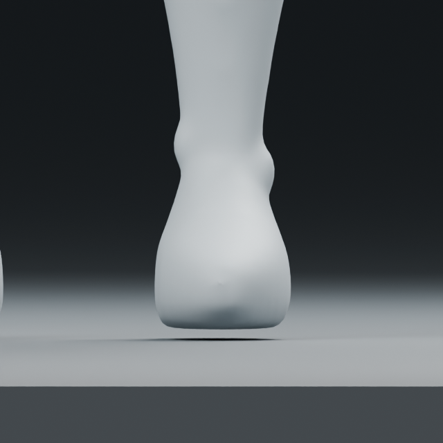 |
| Oblique | 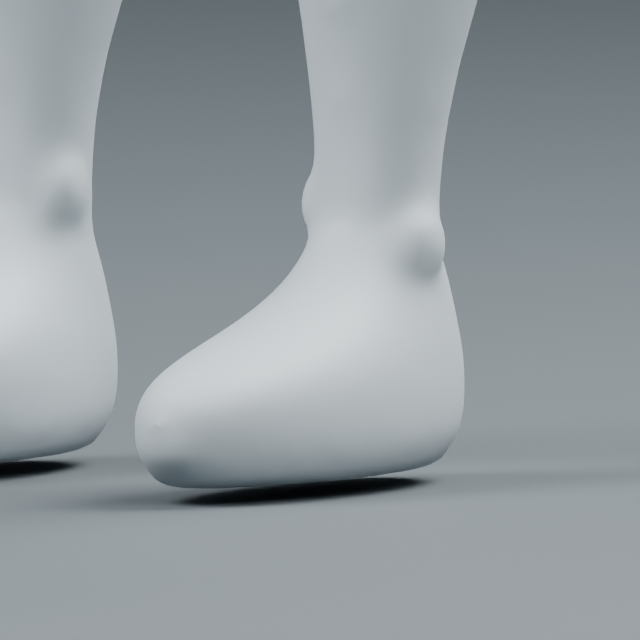 | 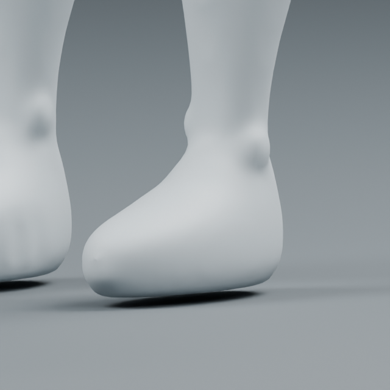 |

## Five-toe forefoot stock - 2026-10-24

`regions.foot.build(name, scale, side)` creates a new closed forefoot stock from
six preserved construction parts and local 1 mm voxel fusion. Authored centers,
lengths and radii live in `knowledge/body/toe-structure-v1.json`; the hallux is
medial and larger. Anatomical relationships are sourced separately from these
modeling dimensions. Original character and construction parts are preserved.
Invalid scale/side/name guards and late-fusion cleanup are included.

Blender 5.2.2 LTS, tested default right stock: 32,120 vertices, one connected
closed oriented surface. Four gap rays and five toe-hit rays at Y=-.160 m pass.
Original coordinates and input hash unchanged; invalid scale, injected late
fusion failure cleanup and saved native readback pass. The first gap probe
accidentally lay on a toe boundary; it was corrected to the midpoint of the
authored free interval, with no geometry or tolerance relaxation.

Actual top/oblique views inspected. This is a separate prototype, NOT attached
to the character. The forefoot root is blocky, toe tips slightly pointed, and
joint/nail details absent. Next: explicit forefoot graft preserving existing
heel/ankle, then local connection review. Stage E and full goal remain active.

Prototype: `runs/human/forefoot-stock/forefoot-stock.blend`, object `Forefoot stock`.
Current character stays `runs/human/foot-relief/foot-relief.blend`.
`examples/human/legs/toes.py` takes foot-relief native and a fresh folder.
One Blender process/two threads, exited.

[OpenStax toe structure](https://openstax.org/books/anatomy-and-physiology-2e/pages/8-4-bones-of-the-lower-limb)
identifies the medial hallux and its two phalanges; the other toes each have
three. Current skin stocks do not yet model those individual joints.

| Top | Oblique |
| --- | --- |
| 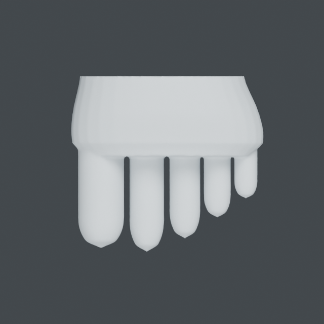 | 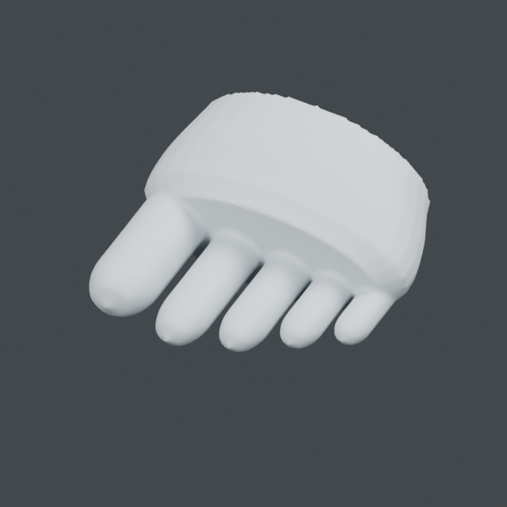 |

## Bilateral forefoot graft - 2026-10-24

`regions.footgraft.replace_forefoot` makes an explicit new topology snapshot.
Restricted standing-frame cuts at Y=-.112/- .125 m retain existing heel/ankle
vertices. Four 64-point Hermite rings bridge each 54-to-296 boundary. Only added
stock/ring vertices are welded; original retained vertices remain exact.
This is a local procedural-stock graft, not arbitrary retopology.

Blender 5.2.2 LTS: both seams closed/oriented, 862 candidate seam triangles each,
262/260 stock vertices welded within .01 mm. 155,080 protected heel/ankle/upper
body points survive exactly. Original coordinates/topology, invalid cuts,
injected late-failure cleanup, no stale keys/groups on new topology, eight gap
rays, ten toe hits, native readback and input SHA pass. Older layers/masks remain
on the preserved original, not on the replacement topology.

Saved comparisons show attached toes but a thick forefoot-root rim remains.
Toe tips, root shape and floor contact remain unfinished. Next is local root
transition shaping. Stage E and the full goal remain active. The initial top
camera was obstructed by the upper body, then clipped the calf; only this view
was recaptured from above/front. Passed geometry checks were not repeated.

Current native: `runs/human/feet-grafted/foots-grafted.blend`, object
`Forefoots grafted study`. `examples/human/legs/attach.py` takes foot-relief native
and a fresh output folder. One Blender process/two threads at a time; exited.

| View | Before | After |
| --- | --- | --- |
| Above/front | 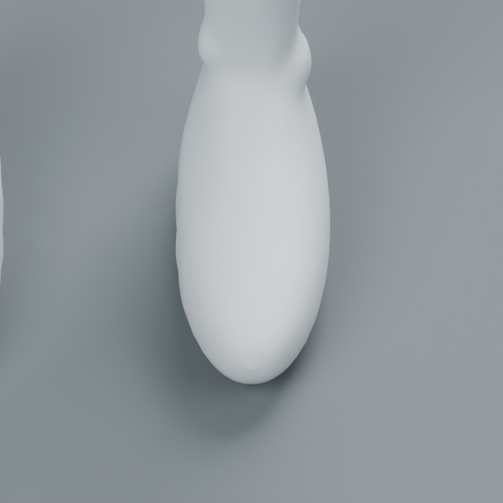 | 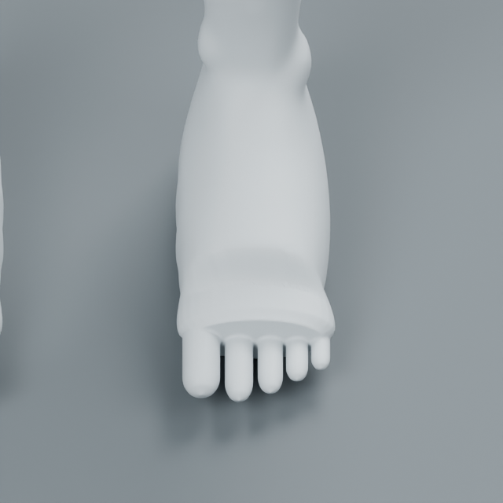 |
| Oblique | 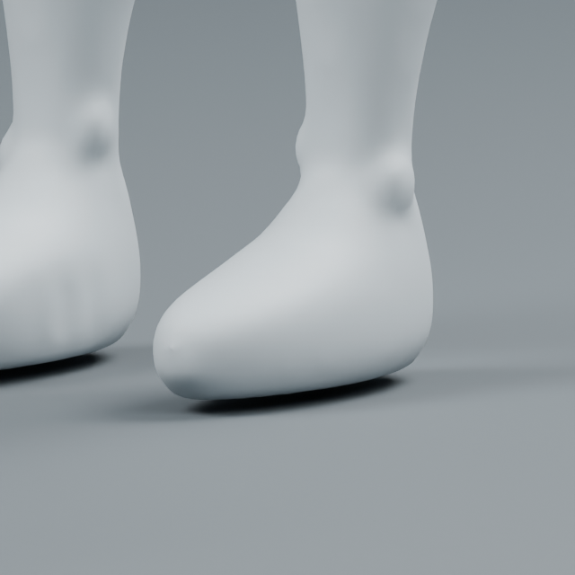 | 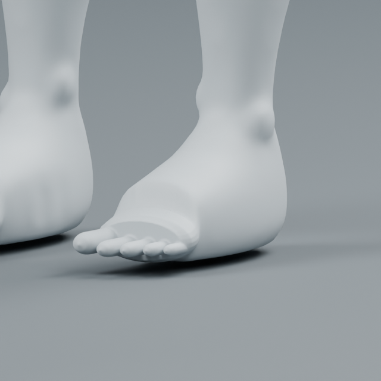 |
