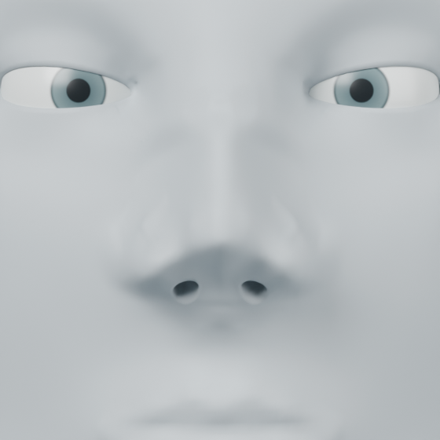
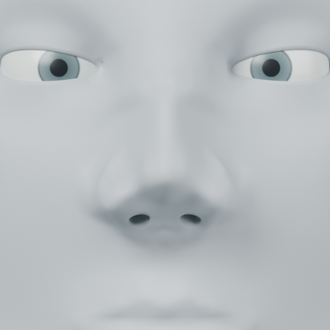
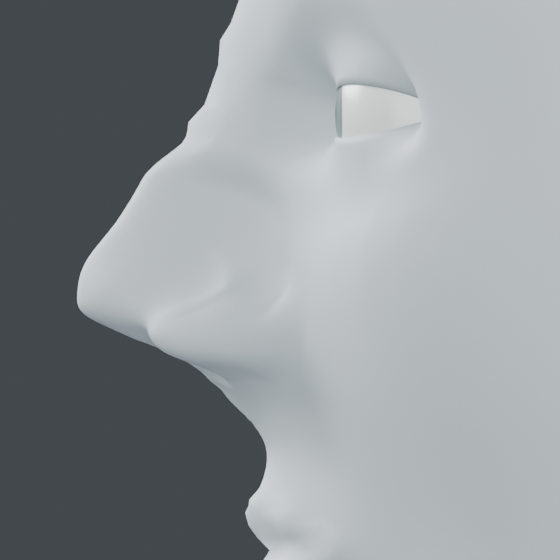
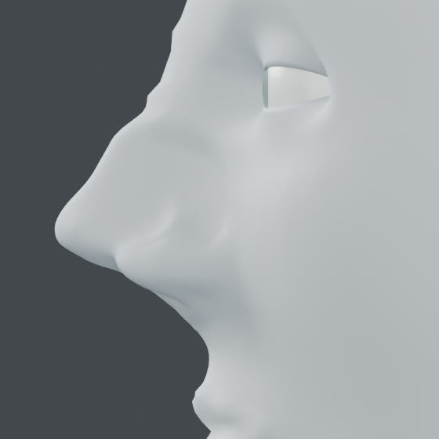
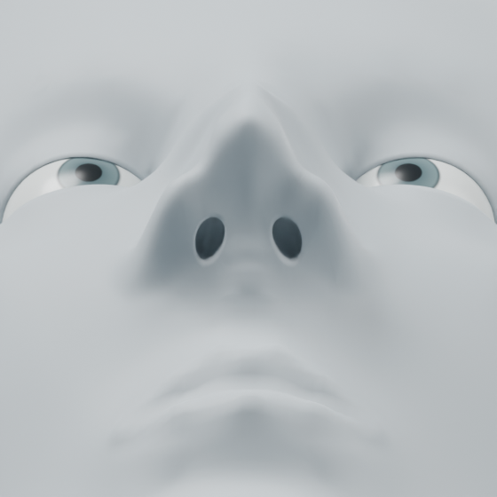
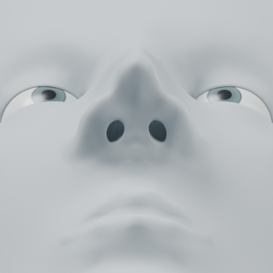
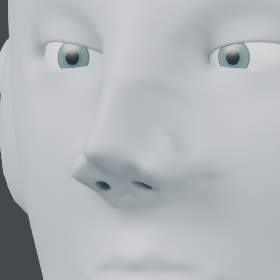
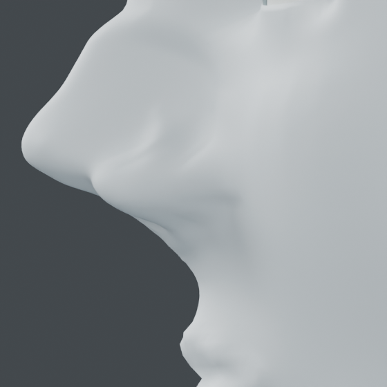
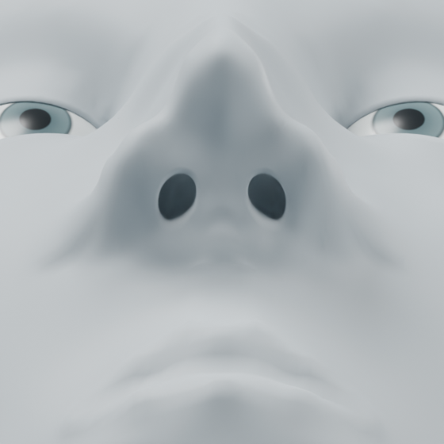

# Lower-nose connection controls

## Scope and acceptance ? 2026-10-24

Completed bounded pass: refine the tip, alar rim and columella-to-philtrum transition on the
preserved integrated procedural character. No other region or compatibility
matrix is included. Acceptance requires source/outside-region preservation,
reversible deformation, invalid-input and late-failure cleanup, saved native
readback and actual front/profile/basal before-after inspection.

[NIH nose anatomy](https://elementsofmorphology.nih.gov/anatomy-nose.shtml)
distinguishes the tip, lateral ala surrounding the naris and the columella linking
tip and base between the nares. Those surface relationships motivate separate
control groups. They do not establish universal dimensions or a cartilage fit.

`mesh_workbench.assembly.nose.compile_controls` projects manually registered
external rays onto entering skin. `tip_mm`, `ala_mm` and `columella_mm` independently
weight named offset paths. Invalid vectors, missing groups, duplicate names and
misses are rejected before mutation. Existing surface interpolation, displacement
and polygon guards apply through `curve_fit`; the result is a new object with a
reversible layer. Original mesh, masks and layers are retained.

The example is `examples/human/nose/refine/connections.py`; arguments are the
integrated native and a fresh output folder. Its 39 rays describe tip shoulders,
upper-tip transition, alar outer/lower margins, attachment guards and the central
columella, including 16 basal rays around the outer entrance margins. Offsets are authored design choices. The input is the first integrated
character, not the proportion variant. CPU and numerical libraries are limited
to two threads, with one Blender process.

## Result

Blender 5.2.2 LTS: 39 controls, maximum displacement 1.30935 mm, 189,869
protected vertices unchanged and 4,422 moved vertices. Minimum changed polygon
area ratio .73332. Source, topology, rollback, invalid ray, injected layer-finish
failure cleanup and saved readback pass. Front, profile and basal views inspected.
The first 23-ray trial had too little rim effect; 16 basal rim rays were added.
The selected result rounds the tip profile, strengthens the lower rim and changes
its connection to the columella. The apertures remain regular ovals and the alar
attachment remains broad; this is an incremental surface refinement, not a
realistic finished nose. Internal cartilage and airway are not reconstructed.

| View | Before | After |
| --- | --- | --- |
| Front |  |  |
| Profile |  |  |
| Basal |  |  |

## Single editable delivery

At the user's request, the selected scene was compacted into
`runs/human/current/character.blend` (10,301,372 bytes, 9.82 MiB).
106 mesh datablocks became four: body, two eyes and studio floor. Cameras/lights,
current geometry, topology, vertex groups and both Basis/nasal shape keys survive
exact native readback. No geometry was decimated. Compression is enabled.
`examples/human/integration/compact.py` performs this packaging without deleting
its input; filesystem cleanup was a separate authorized operation.

73 historical native/backup files totaling 13,280,888,475 bytes were deleted after
verification. Only one native remains under `runs/human/`. The old topology
snapshots and distinct proportion variant are no longer available locally.
Scripts, JSON reports and comparison images remain; historical native paths in
older reports describe past runs, not currently available files. The current
shape keys restore the current mesh's pre-nasal state, not all earlier topology
versions. Local cleanup plan/result and compact readback evidence are in
`runs/human/current/`.

## Alar-cheek attachment pass - 2026-10-24

Scope: lateral alar volume and cheek attachment only; tip and entrance rims
remain outside the deformation bounds. `compile_attachment` samples registered
lateral rows, retaining endpoints and blending their depth toward a smooth
endpoint transition. `fairing` and `volume_mm` separately control the attachment
and shallow alar volume. `apply_attachments` compiles both sides before mutation,
rejects overlapping bounds and removes both intermediates on late failure.

The example `examples/human/nose/refine/attachment.py` takes the current native
and a fresh output directory. It uses four rows with six stations on each side.
The first .65 fairing setting exceeded the unchanged 3 mm displacement guard;
the selected default is .25 with .2 mm volume. The central |X| <= 13.5 mm band
containing tip and entrance rims is excluded. These are registered geometric
bounds for this character, not automatic anatomical detection.

Acceptance: source/outside-region/central-nose equality, layer rollback, invalid
station order, second-side failure cleanup, sampled slope-change reduction,
saved readback and actual oblique/profile comparisons. Blender is limited to
one process and two CPU/numerical threads. Final current native is replaced only
after inspection; earlier state remains in the reversible layers.

The initial 6 mm support radius passed numeric guards but produced a new
side-view bump, so that candidate was rejected. The corrected pass uses a
12 mm support radius and 2 mm region feather; visual acceptance is checked
again because of that specific defect. The current native remains untouched
until a candidate is accepted.

Selected result: Blender 5.2.2 LTS, 48 controls in two reversible layers, maximum
movement 2.485 mm and minimum changed-face area ratio .63758. 197,035 protected
vertices and 7,808 central-nose vertices remain exact. All listed checks pass.
Summed sampled changes in lateral slope decreased 24.5%; this is a local
geometric measure, not an anatomical accuracy score. The corrected side view
removes the new bump and softens the original attachment transition. A broad
attachment and stylized alar shape remain.

Current `runs/human/current/character.blend` is 13,931,813 bytes (13.29 MiB).
Both new layers can be set to zero to recover the exact previous state. The
accepted candidate replaced the original only after readback/image inspection
and source/hash checks. Rejected candidate was removed; one human native remains.

| View | Before | After |
| --- | --- | --- |
| Oblique |  |  |
| Profile |  |  |

## Columella-philtrum junction - 2026-10-24

Scope: central subtip/columella curvature and basal contact with the philtrum.
`nose.compile_columella` takes explicitly registered ordered height stations
with separate projection and junction weights. A narrow central strip keeps
the lateral entrance rims and lips outside its deformation bounds. This is
manual surface registration, not automatic subnasale detection or an anatomical
nasolabial-angle target. Existing NIH surface terminology in this document
motivates the distinction; the offset amounts are authored design choices.

`examples/human/nose/refine/columella.py` takes the current native and a fresh
folder. Thirty-five surface controls span seven heights and five lateral stations,
with .25 mm projection and .25 mm junction recession. A cosine-squared lateral
weight reduces the offset smoothly toward the protected sides. The registered half-width is 2.8 mm and lower
boundary is above the upper lip. A continuous compact-support deformation and a reversible layer
preserve topology and prior layers. Required checks cover source/outside-region
equality, rollback, invalid station order, injected layer-finish failure cleanup,
control-to-surface residual and saved readback, followed by profile/basal views.
Only this region is tested; one Blender process and two numerical/CPU threads.

The first 21-control candidate produced a small slot-like basal indentation
and was rejected despite passing numeric guards. The corrected profile reduces
the junction offset and adds tapered lateral stations. Only the specific
profile/basal checks are repeated for this visible defect.

The tapered surface-interpolating candidate still showed a small pointed
indentation: mesh-fitting amplification reached .963 mm for .25 mm authored
offsets. It was also rejected. The selected method uses the continuous RBF
field with 12 mm support rather than exact sampled-surface interpolation, and
a stricter .8 mm displacement cap. Target-surface residual remains checked.

Selected pass: Blender 5.2.2 LTS, 35 controls, maximum movement .25483 mm,
198,118 protected vertices exact, 361 moved vertices, minimum changed-face area
ratio .95303 and maximum target-surface residual .01038 mm. Source, rollback,
invalid station order, late-failure cleanup and saved native readback pass.
Actual profile and basal views confirm a subtle central curvature/contact change
without the new slot/point seen in the rejected fits. The broad, simplified
nasolabial surface remains; this is not a completed realistic nose.

Only native: `runs/human/current/character.blend`, 15,747,055 bytes (15.02 MiB).
Disable `MW columella philtrum junction` for the exact preceding state. The
accepted native was promoted after source-hash and saved-readback verification;
both rejected natives and the temporary backup were removed. Reports and
comparison images remain. No other model or anatomical region was changed.

| View | Before | After |
| --- | --- | --- |
| Profile |  |  |
| Basal |  |  |
