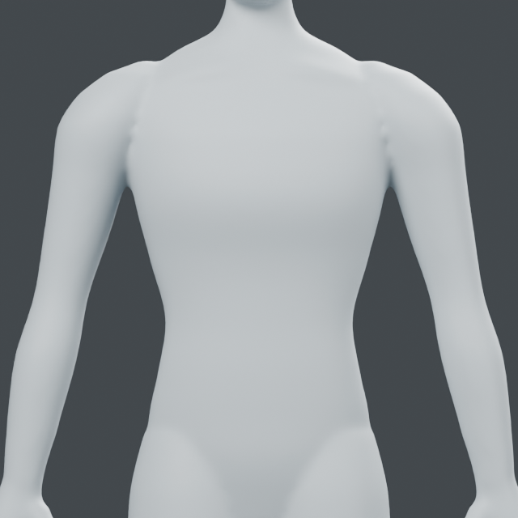
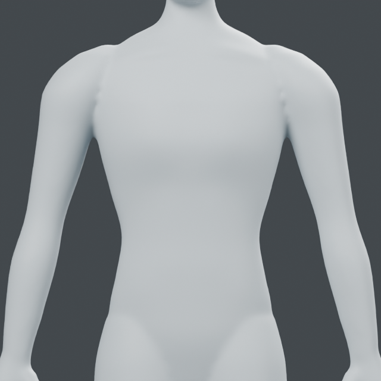
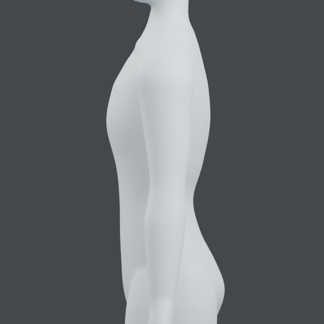
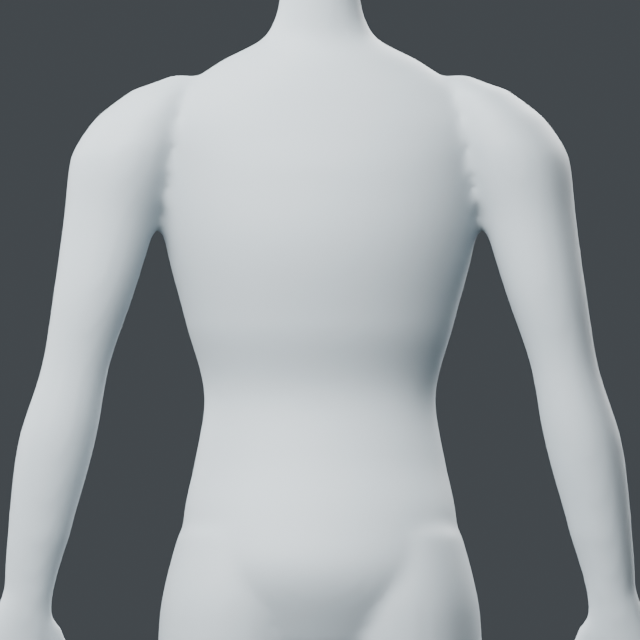
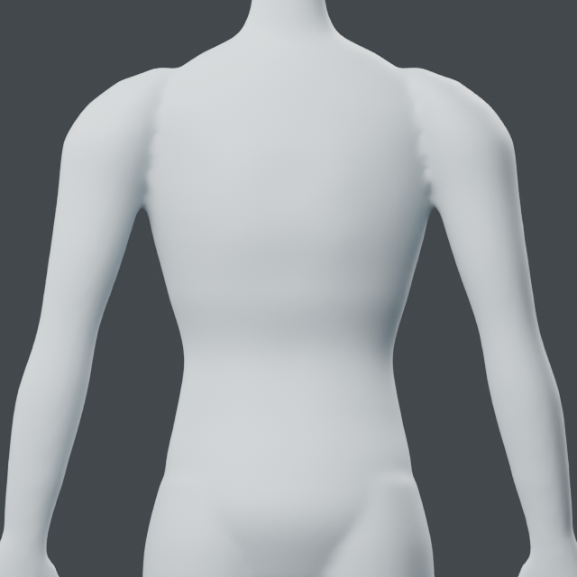
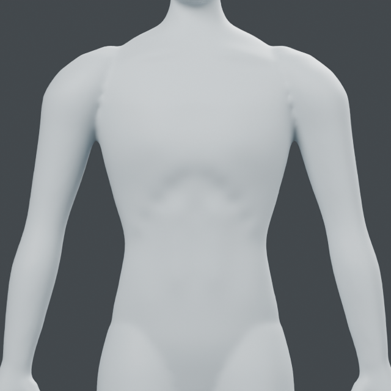
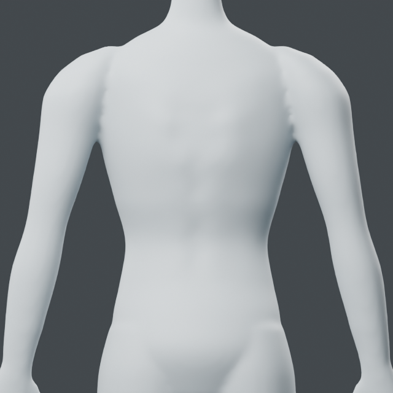
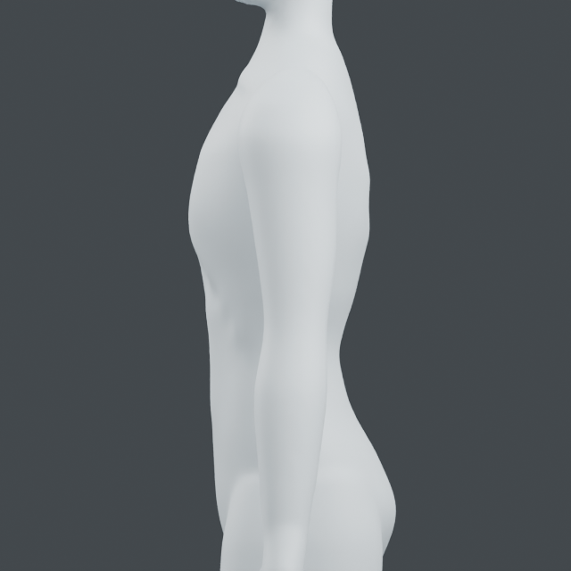
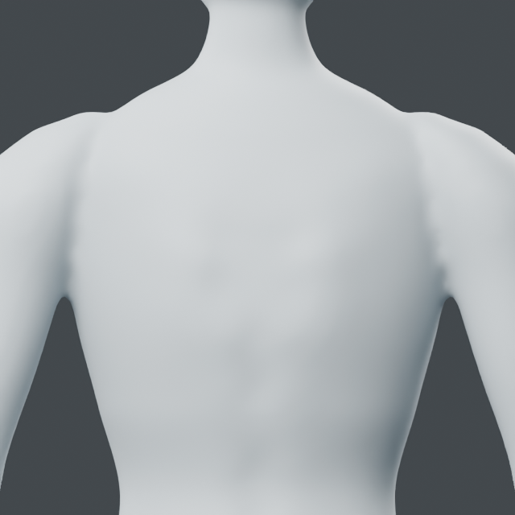
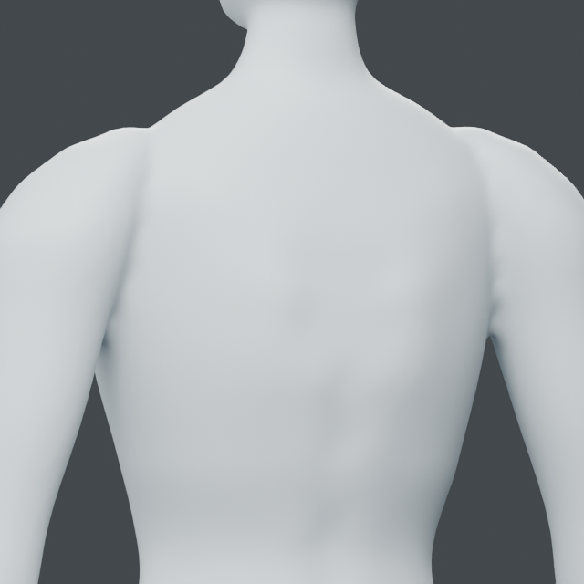

# Registered torso controls

Stage C remains in progress. This pass establishes 29 front/back skin controls
for sternum, thorax, costal transition, abdomen, pelvic transition and back.
The actual render shows subtle volume separation; costal margins, abdominal
planes and scapular form remain insufficient. Existing armpit junction roughness
also remains. Next: costal margin and abdominal connection, within stage C.

## Relationship sources and authored dimensions

[OpenStax thoracic cage](https://openstax.org/books/anatomy-and-physiology-2e/pages/7-4-the-thoracic-cage)
supports the anterior sternum/ribs/posterior vertebrae relationship.
[OpenStax pelvic girdle](https://openstax.org/books/anatomy-and-physiology-2e/pages/8-3-the-pelvic-girdle-and-pelvis)
supports the iliac crest and pelvis/sacrum relationship.
No source image or numerical body proportion is copied. Control coordinates,
depth changes and radii are authored modeling values, not anatomical measurements.
Skin probes named sternum/waist/pelvis do not locate underlying bone automatically.

## API and preserved inputs

`from mesh_workbench.regions import torso`

`torso.compile_controls(source, target, relief=1)` emits a sampled-surface
`curve_fit` diagram using `torso-surface-v1`. Target requires three visible front
XYZ references (`sternum`, `waist`, `pelvis`), descending Z and aligned midline,
`half_width_m` and a protected `region`. Coordinates use front -Y, up Z.
This trial uses half-width 0.13 m, radius 91 mm, feather 15 mm and an 8 mm
maximum displacement. Curve-fit accepted radius/feather ranges now extend to
150/30 mm for torso scale; polygon guards and displacement checks are unchanged.

Run `examples/human/torso/audit.py` and `planes.py` with the preserved
`runs/human/rebuilt-underside/rebuilt-underside.blend` and separate fresh output
folders. Current result: `runs/human/torso-planes/torso-planes.blend`, object
`Torso plane study`, reversible layer `MW torso planes`.

## Focused evidence

Blender 5.2.2 LTS; one process, two CPU/numerical threads. 29 controls,
10,168 changed vertices, maximum displacement 3.66272 mm, maximum nearest-surface
control residual 0.00788 mm. Minimum changed polygon area ratio 0.97627.
77,457 vertices outside the box [-.17,-.15,.96] to [.17,.15,1.42] remain exact.
This is spatial protection, not automatic anatomical limb segmentation.
Source geometry/topology, layer rollback, invalid reference order rejection,
injected late-failure object/mesh cleanup, native reopen and input SHA256 pass.
No global collision or anatomical accuracy claim. Reports and diagram are in
`runs/human/torso-planes/`. Three matched 640px, 16-sample views were inspected.

| View | Before | After |
| --- | --- | --- |
| Front |  |  |
| Side |  |  |
| Back |  |  |

## Costal and abdominal profile

`torso.compile_controls(source, target, profile="abdomen")` now provides 41
front skin controls, with paired costal edges and lower transitions, paired
rectus volumes, lateral boundaries and anterior midline. The relationship of
paired rectus and midline linea alba to lateral obliques is supported by
[OpenStax abdominal wall](https://openstax.org/books/anatomy-and-physiology-2e/pages/11-4-axial-muscles-of-the-abdominal-wall-and-thorax).
All spacing and displacement values remain authored. No source artwork is used.

Run `examples/human/torso/abdomen.py` on the preserved torso-planes native into
a fresh output folder. Current saved result is
`runs/human/costal-continuous/costal-abdomen.blend`, object `Costal abdominal study`.
The initial 39 mm radius caused separate visible dimples despite passing geometry
checks. A denser-control trial exceeded the 0.2 mm surface residual tolerance and
was not saved. The final 41-control, 71.5 mm radius pass retains the same tolerance
and produces a more continuous costal arch. Slight waviness remains; this is not
an anatomical muscle reconstruction. Tendon intersections and navel are absent.

Blender 5.2.2 LTS: maximum move 2.90274 mm, 3,382 changed vertices, 86,653
protected vertices exact; minimum changed polygon area ratio 0.87959.
Protection box is [-.17,-.15,.96] to [.17,-.015,1.31], feather 15 mm.
Source, topology, rollback, invalid reference order, unknown profile rejection,
injected late-failure cleanup, saved-native readback and input hash pass.
Three saved-model views inspected; one process, two threads, exited.
Stage C remains active. Next: posterior thorax/scapular connection, with the
remaining costal waviness retained as an unresolved visual limitation.

| View | Before | Current |
| --- | --- | --- |
| Front |  |  |
| Side |  |  |

## Posterior torso profile

`profile="back"` compiles 34 posterior controls: broad scapular planes, medial
transitions, paired paraspinal volumes and a protected anterior surface.
[OpenStax pectoral girdle](https://openstax.org/books/anatomy-and-physiology-2e/pages/8-1-the-pectoral-girdle)
supports the medial-border, inferior-angle and posterior-spine relationships.
Depths and coordinates are authored skin relief, not measurements of underlying
bones. The front reference heights remain the common registration frame.

Run `examples/human/torso/back.py` on the costal-continuous native with a fresh
output folder. Current result: `runs/human/posterior-torso/posterior-torso.blend`,
object `Posterior torso study`, reversible layer `MW torso back`.
Blender 5.2.2 LTS: 3,768 changed vertices, maximum move 3.62591 mm,
86,213 protected vertices exact, minimum changed polygon area ratio 0.98103.
The box [-.16,.015,1.04] to [.16,.18,1.43] protects the anterior surface.
Source/topology, rollback, invalid order/unknown profile, injected late-failure
cleanup, native readback and input hash pass. Surface target residual is below
0.2 mm. Two saved-model views inspected, one process/two threads, exited.

The scapular volume is shallow; this does not reconstruct bones or moving
scapulae. The rough posterior armpit junction remains visible and is the next
specific torso repair. Costal waviness and anatomical simplification remain.
Stage C is not complete.

| View | Before | Current |
| --- | --- | --- |
| Back |  |  |
| Side |  |  |

## Posterior axillary junction fairing

Reused `surface_brush.apply` with two posterior visible-surface paths, one per
side. `examples/human/torso/axilla.py` projects authored paths on the preserved
posterior-torso native and applies reversible volume-preserving relaxation.
This is a local junction repair, not a new anatomical claim or reconstructed
axillary fold. Radius 20 mm, strength 0.4, eight iterations, 3 mm cap.

The initial inner path missed the visible seam. Moving the path laterally located
the defect; a stronger setting exceeded the existing displacement cap and was
rejected without saving. The accepted setting reduces small scallops in both
back and oblique views. A broad groove and simplified shoulder anatomy remain.
No guards or tolerances were weakened. The next stage C item is waist/flank to
upper-pelvis connection; stage C remains incomplete.

Blender 5.2.2 LTS: 90,143 vertices outside the two boxes remain exact. Source
and topology preserved, both layers roll back exactly, invalid second stroke
and injected finish failure leave no snapshot/mesh, saved-native readback and
input SHA pass. Each stroke passes polygon orientation/area and stored-volume
checks. One process/two threads; exited. The saved result is
`runs/human/axillary-junction/axillary-transitions.blend`, object
`Axillary transition study`. Diagram, commands and report are adjacent.

| View | Before | After |
| --- | --- | --- |
| Back |  |  |
| Oblique |  |  |
