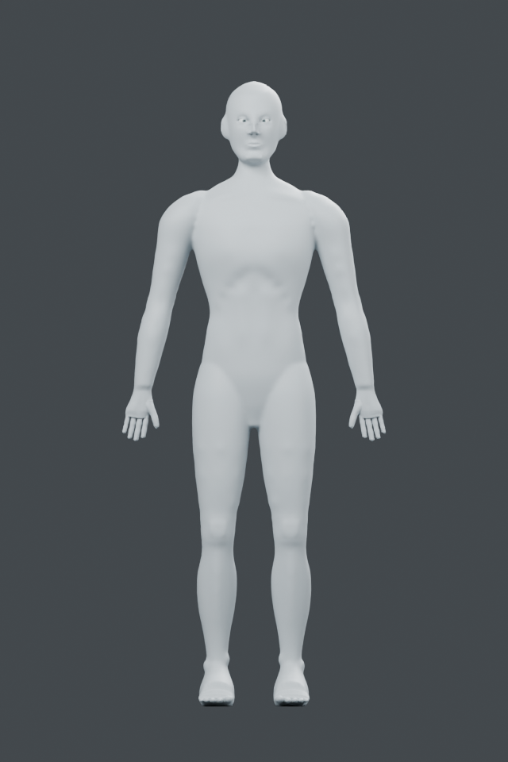
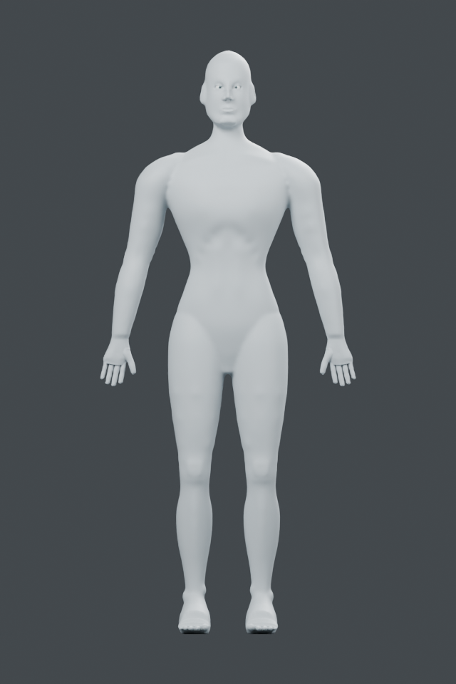
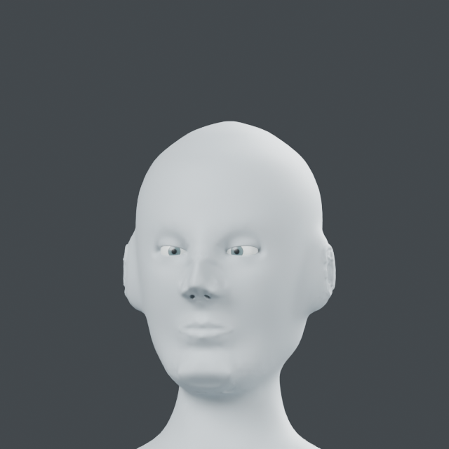
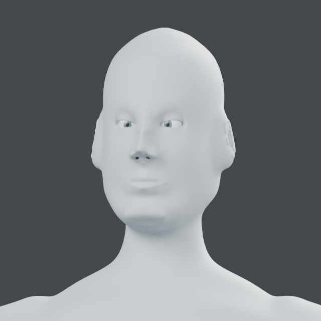
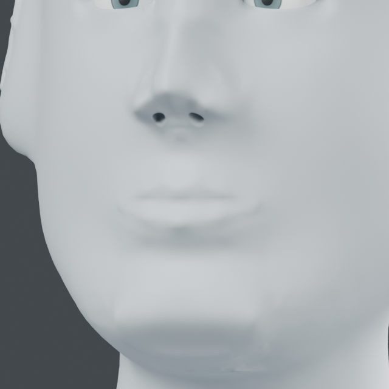
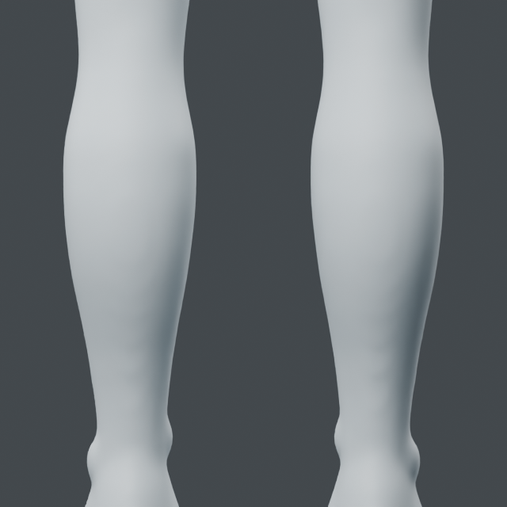
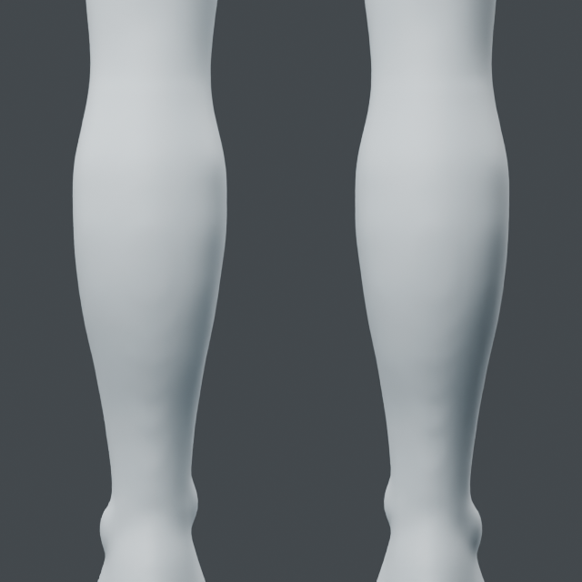

# Face/body variation and tool reuse

## Distinct face/body variant with registered guides - 2026-10-24

`assembly.variant.apply` builds a new body/eye assembly with one reversible
proportion layer per member. Positive height-dependent width/depth sections and
bounded Y offsets alter the face, shoulder, waist and pelvis; a separate lateral
width blend keeps torso changes from bending the hanging arms. All targets and
polygon orientation/area guards are checked before mutation; late failures
remove every new object/mesh. Original body/eyes remain intact.

Blender 5.2.2 LTS: height 1.747222 -> 1.817110 m (1.04 scale), minimum polygon
area ratios .85504 body / .85378 eyes. Source/topology, layer rollback, invalid
scale, second-member failure cleanup and saved readback pass. All 40 existing
guide rays are transformed and re-registered with the same guides API and new
bounds. Saved body and face comparisons inspected. The first global-width
candidate bent the arms; the corrected lateral blend is the selected result.
An initial post-load object-reference error was fixed by resolving stored names.

This is a parameterized variant of the same topology, not a new anatomical
scan or automatic generalization. Eyes share the field and are not rigid spheres.
The local-tool reuse gate is recorded below.

Selected native: `runs/human/variant-b-limbs/variant.blend`, objects `Variant B 0`
(body), `Variant B 1/2` (eyes). Profile, registered guides and verification are
adjacent. `examples/human/integration/variant.py` takes integrated native,
registered guide JSON and a fresh folder. One Blender process/two threads, exited.

| View | Original assembly | Selected variant |
| --- | --- | --- |
| Body |  |  |
| Face |  |  |

Profile values are authored design choices, not population anatomy statistics.
The previous integrated character remains the baseline. Reusable local tools
must compile against the variant surface and its separate registration; merely
scaling the original result is not the final reuse acceptance gate.

## Existing local tools reused on the variant - 2026-10-24

The unchanged oral-relief and bilateral calf APIs now compile against separately
registered coordinates on the second character. The script projects mouth
landmarks onto its actual skin and maps calf axes/bounds through the recorded
proportion field. Three reversible layers contain 132 controls. All 40 guide
rays are re-registered on the final surface.

Blender 5.2.2 LTS: maximum displacement .903 mm at the mouth and 3.011 mm at
the calves; maximum fitting residual .02517 mm. 189,736 protected vertices,
original body/eyes and topology remain unchanged. Disabling the three new
layers restores the input variant. Invalid oral/calf registration and an
injected final-calf failure pass; the latter removes all intermediate outputs.
Saved native readback and unchanged input SHA256 pass. Four actual before/after
renders were inspected: the lip-volume change is subtle, and calf silhouettes
are broader. The nose, facial planes, ankle bulges and simplified surfaces
remain visibly unfinished.

Selected native: `runs/human/variant-reuse/reused.blend`, body
`Variant reused study`, eyes `Variant B 1/2`. Registration, guides and verification
are adjacent. Run `examples/human/integration/reuse.py` with the variant native,
original `assembly.json` and a fresh output folder. This establishes representative
oral/calf reuse on a manually registered same-topology variant, not every tool
on arbitrary meshes. One Blender process, two threads, exited successfully.

| View | Before reuse | After reuse |
| --- | --- | --- |
| Mouth |  |  |
| Calves |  |  |
